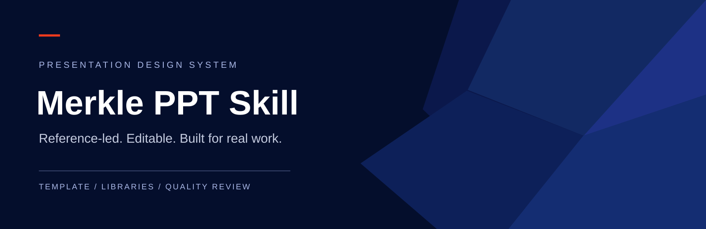
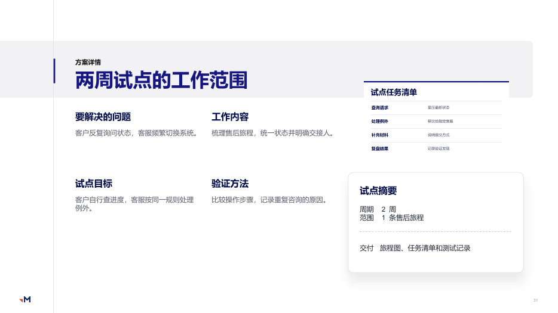
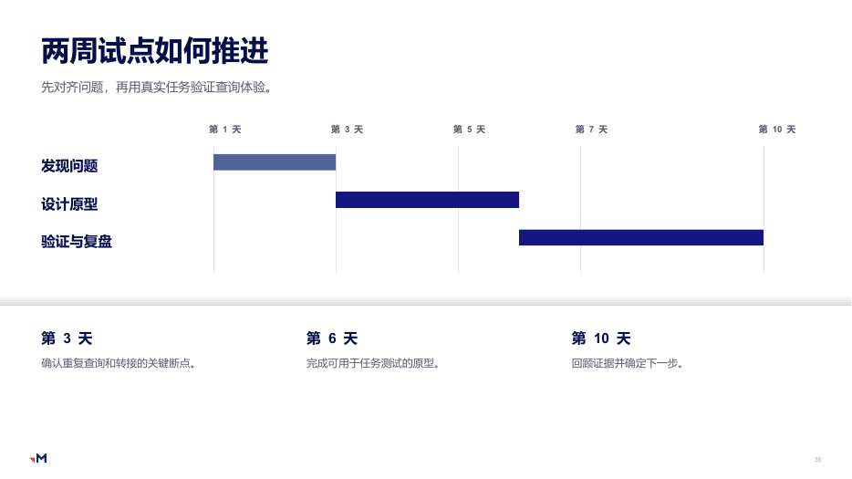
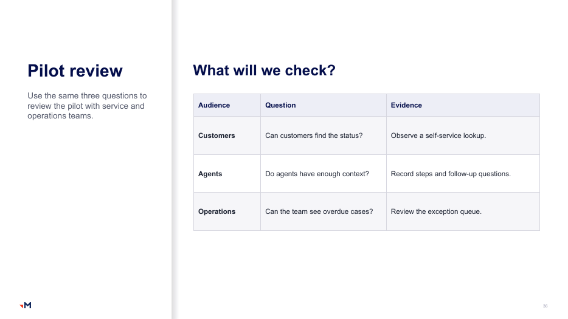
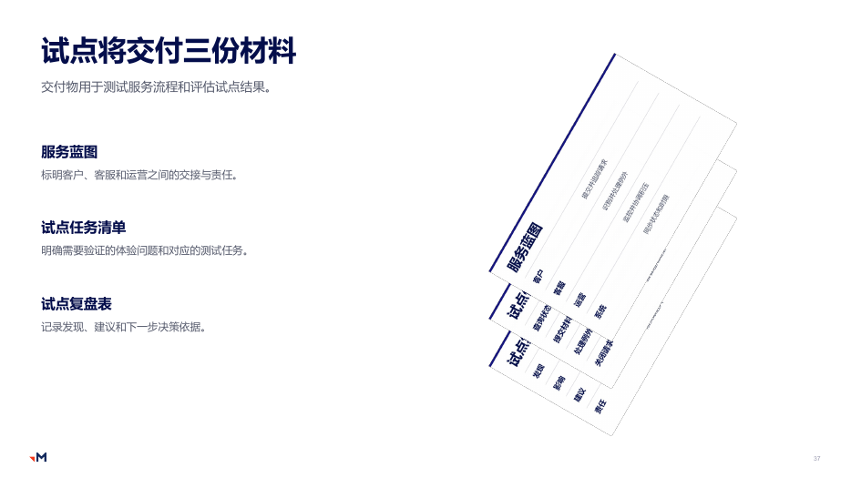

<p align="left"></p>



**面向真实工作场景的 Merkle 演示文稿制作体系**  
**A reference-led workflow for editable Merkle presentations**

[中文](#中文) · [English](#english) · [Visual references](#visual-references--视觉参考) · [Libraries](#五个参考库) · [Install](#获取与安装--get-started)

---

## Visual references / 视觉参考

The following examples illustrate content structures and visual approaches from earlier demos. They are references, not fixed templates; the current title, typography and divider rules below take precedence.

以下示例展示早期 DEMO 的内容结构与视觉方法，供选型参考。**当前标题、字体及分割线规则以下方说明为准。**

| Solution detail / 方案详情 | Timeline / 时间安排 |
| :---: | :---: |
|  |  |
| **结构化展示问题、方案与交付** | **以时间关系组织阶段与里程碑** |

| Summary & evidence / 摘要与证据 | Deliverables / 交付物展示 |
| :---: | :---: |
|  |  |
| **让结论与支持信息并列** | **用可编辑说明配合视觉示例** |

> Reference pages inform the design. New presentations should use project-approved content and be checked in the target PowerPoint environment.

---

## 中文

Merkle PPT Skill 帮助支持读取本地文件和制作演示文稿的 AI 助手，基于官方模板、版式案例和品牌素材，制作、编辑及检查可编辑的 PowerPoint。它将内容组织、页面选型、图标与图示选择、样式参考和交付检查串成一套工作流程，适合方案汇报、客户案例、项目进展及架构说明等场景。

### 核心能力

- **以官方模板为基础制作。** 新建演示文稿时使用 2026 Merkle Arial 模板，保留幻灯片母版、主题和 35 个命名版式。根据页面任务选择版式，沿用合适的边距和正文起点；常规内容页标题按统一规则定位，需要自由组织时可使用自定义版式。
- **根据内容关系选择页面。** 对照 Slide Library 判断内容适合比较、时间安排、流程、证据展示还是其他形式；案例和架构图还可分别参考 Case Library 与 Diagram Library；业务回顾和阶段汇报可结合 QBR Library。参考页提供结构和视觉方法，不应机械照搬原业务内容。
- **保持 PowerPoint 可编辑。** 文本框、形状、连接线、表格和适用的图表应使用可编辑、可组合的原生对象；连续段落保留在单个文本框内，使用自动换行。照片、品牌图形及原始 SVG 等素材可作为独立图片对象使用。
- **追溯具体视觉样式。** Slide、Case、Diagram 和 QBR 资料包含对象级样式记录，可按源文件、页码和对象定位，检查颜色、渐变、透明度、边框、阴影、3D、图层及主题继承。具体交付仍需在目标 PowerPoint 环境中核对，不能仅凭属性记录认定完全一致。
- **优先使用原始图标。** ICON Library 包含 583 条图标索引，记录图形含义、潜在场景与源 PPT 定位。使用原始图标对象或原始 SVG；使用其他版本前应核实其外观与原图完全一致。
- **检查内容与呈现。** 工作流程要求核对事实与建议的区别、页面边界、文字溢出、字体替换、对象可编辑性、品牌元素和渲染效果。参考材料中的客户信息、数据和项目描述不能自动作为新项目的事实。

用户当前任务、客户模板和明确要求优先。这里的品牌和版式参考是基于所提供资料整理的工作指南，不等同于经过审批或始终最新的官方品牌规范。

### 默认设计规则

正文英文默认使用 **Arial**，中文使用 **微软雅黑**。常规内容页标题统一为**黑色、加粗、24 pt**，标题框距左 **1.48 cm**、距上 **1.27 cm**；特殊布局可以调整标题位置，并在深色背景上使用对比色。正文分段标题通常为 **16 / 14 pt**，详情通常为 **12 pt**。

普通浅色内容页继承左下角 M 角标和右下角页码；中央 dentsu 标志仅在明确要求时加入。结束页保留模板的 M 标志和版权行，默认不添加其他文字。页面级渐变分割带每页最多一次：纵向仅用于专门的左右分区版式，普通页面通常不使用横向分割带。有限时间线在首尾节点处结束。

### 五个参考库

| Library | 内容 | 直接在 GitHub 查看 | 下载后离线搜索 | 原始 PPT |
| --- | --- | --- | --- | --- |
| ICON | 583 条图标索引，含用途与源文件定位 | [图标目录](libraries/icon-library.md) | [HTML](libraries/icon-offline.html) | [ICON PPT](merkle-ppt/assets/Merkle_icon.pptx) |
| Slide | 139 页内容页和其他版式参考 | [版式目录](libraries/slide-library.md) | [HTML](libraries/slide-offline.html) | [Slide PPT](merkle-ppt/assets/Slide%20Library%20for%20ai.pptx) |
| Case | 45 页短案例、扩展页和旗舰案例参考，含说明页 | [案例目录](libraries/case-library.md) | [HTML](libraries/case-offline.html) | [Case PPT](merkle-ppt/assets/case%20library%20-%20Case%20Study%20Layout%20Types.pptx) |
| Diagram | 15 页图示素材，重点覆盖技术架构、数据流和系统关系 | [图示目录](libraries/diagram-library.md) | [HTML](libraries/diagram-offline.html) | [Diagram PPT](merkle-ppt/assets/Diagram%20library%20-%20Diagram%20Elements.pptx) |
| QBR | 156 页业务回顾、阶段汇报和规划版式 | [QBR 目录](libraries/qbr-library.md) | [HTML](libraries/qbr-offline.html) | [QBR PPT](merkle-ppt/assets/QBR%20SLIDE%20LIBRARY.pptx) |

GitHub 可直接显示目录文字和预览图。交互式 HTML 需先下载，再用浏览器打开；安装 `merkle-ppt` 时不会自动安装仓库外层的图鉴，skill 本身已包含源 PPT 和索引。[Slide](libraries/slide-object-styles.csv)、[Case](libraries/case-object-styles.csv)、[Diagram](libraries/diagram-object-styles.csv) 和 [QBR](libraries/qbr-object-styles.csv) 对象索引及[样式记录说明](merkle-ppt/references/source-object-styles.md)可用于定位具体对象。

### 获取与安装 / Get started

这个仓库包含完整的 `merkle-ppt/` 文件夹：`SKILL.md`、模板、素材库、图标、样式记录和辅助文件。**请保留整个文件夹及其内部目录结构**，不要只复制 `SKILL.md`。

1. 在 GitHub 使用 **Code → Download ZIP** 下载并解压，或运行：

   ```bash
   git clone https://github.com/veyziao/Merkle_PPT_skill.git
   ```

   仓库目前为私有时，需要先获授权并使用有访问权限的账号；公开后可直接下载。
2. 按下表将解压或克隆后的 **`merkle-ppt/` 整个文件夹**复制到所用产品的 skill 目录。例如目标是 `.claude/skills/merkle-ppt/SKILL.md`，文件夹中的 `assets/`、`references/` 等也应保留在原位置。
3. 启动新的会话，或按对应产品的方法重新加载 skill，然后在提示中明确要求使用 `merkle-ppt`。选择项目级目录时，需在该项目中运行助手；`~` 表示当前用户的主目录。

| 产品与适用界面 | 项目级目录 | 个人目录 | 官方说明 |
| --- | --- | --- | --- |
| Codex | `.agents/skills/` | `~/.agents/skills/` | [OpenAI](https://developers.openai.com/api/reference/cli) |
| Claude Code | `.claude/skills/` | `~/.claude/skills/` | [Claude Code](https://code.claude.com/docs/en/skills) |
| GitHub Copilot agent | `.github/skills/` | `~/.copilot/skills/` | [GitHub](https://docs.github.com/en/copilot/how-tos/copilot-on-github/customize-copilot/customize-cloud-agent/add-skills) |
| Grok Build | `.grok/skills/` | `~/.grok/skills/` | [Grok Build](https://docs.x.ai/build/features/skills-plugins-marketplaces) |

目录对应具体产品或 agent，不代表同名模型的所有聊天界面都会自动加载 skill。安装成功与否、命令名称和可用工具取决于产品版本及运行环境；如果未自动识别，请先参阅对应产品的官方说明。

**不支持自动发现 skill 的助手：** 如果助手能够访问完整文件夹，可将项目中的 `merkle-ppt/SKILL.md` 指定为入口，并让它按需读取同目录下的 `references/`、`assets/` 和脚本。云端对话需要按平台能力上传或连接文件；只粘贴 `SKILL.md` 无法提供 PPT 模板和素材。不同产品对大文件、图片、文件操作及 PPTX 导出的支持不同，需在实际环境中验证。

### 使用示例

```text
请使用 merkle-ppt skill。先阅读 merkle-ppt/SKILL.md，
根据需要读取其中引用的模板、素材库和版式规则，
再基于我提供的材料制作可编辑的 PowerPoint。
听众是项目管理层；请区分已确认事实与建议。
```

### 更新已有版本

仓库更新不会自动覆盖已安装副本。先备份本地 `merkle-ppt/`，重新下载或拉取仓库，再用更新后的**完整文件夹**替换目标产品对应目录中的旧版本；重新加载或开启新会话。其他工具或平台应遵循其各自的更新方式。

## English

Merkle PPT Skill helps AI assistants with file access and presentation tools create, edit and review editable PowerPoint presentations using an official template, layout references and brand assets. It brings together content planning, layout selection, icons and diagrams, source styling, and delivery checks for proposals, case studies, project updates and architecture presentations.

### Core capabilities

- **Build from the official template.** New decks start from the 2026 Merkle Arial template, retaining its slide master, theme and 35 named layouts. Choose a layout for the page's purpose, retain its appropriate margins and body starting position, and apply the shared title rule to regular content pages. Use the custom layout when free placement is needed.
- **Choose layouts to fit the content.** Consult the Slide Library for comparisons, timelines, processes, evidence and other content relationships. Use the Case and Diagram libraries for relevant case narratives and architecture, and the QBR Library for business reviews and stage updates. Source pages provide design references; their business content should not be copied automatically.
- **Keep PowerPoint content editable.** Use native, groupable text boxes, shapes, connectors, tables and suitable charts. Keep continuous prose in one text box with automatic wrapping. Photos, brand artwork and source SVGs can remain separate image objects.
- **Trace visual styling to source objects.** The Slide, Case, Diagram and QBR libraries include object-level records for locating and inspecting colors, gradients, transparency, outlines, shadows, 3D, layers and inherited theme properties. Validate the actual result in the target PowerPoint environment; recorded properties alone do not establish an exact match.
- **Use the source icons.** The ICON Library contains 583 indexed icons with visual interpretations, possible scenarios and source locations. Use the original PPT object or embedded SVG; verify any alternative is visually identical before use.
- **Review both content and presentation.** The workflow calls for checking facts versus proposals, slide boundaries, overflow, font substitution, editability, brand elements and rendered output. Reference client names, figures and project descriptions are not automatically evidence for a new project.

Current user instructions, client templates and project requirements take precedence. The included design profile is a working interpretation of supplied materials, not an approved or necessarily current official brand manual.

### Default design rules

Body text defaults to **Arial** for English and **Microsoft YaHei** for Chinese. Regular content-slide titles are **black, bold, 24 pt**, with the title box **1.48 cm from the left** and **1.27 cm from the top**. Special compositions may reposition the title and use a contrasting color on dark backgrounds. Body section headings typically use **16 / 14 pt**, and detail text **12 pt**.

General light-background content slides inherit the M mark at bottom left and the page number at bottom right. Add the centered dentsu mark only when explicitly requested. The closing slide retains the template's M mark and copyright line, with no additional text by default. Use at most one page-level gradient divider: vertical dividers are reserved for dedicated left/right compositions, and horizontal dividers are generally omitted from regular pages. Finite timelines end at their first and last nodes.

### Reference libraries

| Library | Coverage | Browse on GitHub | Download for offline search | Source PPT |
| --- | --- | --- | --- | --- |
| ICON | 583 indexed icons, with scenarios and source locations | [Icon catalog](libraries/icon-library.md) | [HTML](libraries/icon-offline.html) | [ICON PPT](merkle-ppt/assets/Merkle_icon.pptx) |
| Slide | 139 pages of content and other layout references | [Slide catalog](libraries/slide-library.md) | [HTML](libraries/slide-offline.html) | [Slide PPT](merkle-ppt/assets/Slide%20Library%20for%20ai.pptx) |
| Case | 45 pages covering short-form, extensions and flagship cases, including guidance pages | [Case catalog](libraries/case-library.md) | [HTML](libraries/case-offline.html) | [Case PPT](merkle-ppt/assets/case%20library%20-%20Case%20Study%20Layout%20Types.pptx) |
| Diagram | 15 pages focused on technical architecture, data flows and system relationships | [Diagram catalog](libraries/diagram-library.md) | [HTML](libraries/diagram-offline.html) | [Diagram PPT](merkle-ppt/assets/Diagram%20library%20-%20Diagram%20Elements.pptx) |
| QBR | 156 pages for business reviews, stage updates and planning | [QBR catalog](libraries/qbr-library.md) | [HTML](libraries/qbr-offline.html) | [QBR PPT](merkle-ppt/assets/QBR%20SLIDE%20LIBRARY.pptx) |

GitHub displays the catalogs and previews directly. Download the interactive HTML files and open them locally in a browser to search. These catalogs live outside the installed `merkle-ppt` folder; the skill itself includes the source PPTs and indexes. Object indexes for [Slide](libraries/slide-object-styles.csv), [Case](libraries/case-object-styles.csv), [Diagram](libraries/diagram-object-styles.csv) and [QBR](libraries/qbr-object-styles.csv), plus the [source-style guide](merkle-ppt/references/source-object-styles.md), help locate individual objects.

### Get started

The complete `merkle-ppt/` directory contains `SKILL.md`, the template, libraries, icons, style records and supporting files. **Keep the entire directory and its structure**; copying only `SKILL.md` leaves out required resources.

1. Download and extract the repository through **Code → Download ZIP**, or run:

   ```bash
   git clone https://github.com/veyziao/Merkle_PPT_skill.git
   ```

   While the repository is private, use an authorized account. Once public, it can be downloaded directly.
2. Copy the complete **`merkle-ppt/` directory** into the appropriate skill directory below. For example, the result should include `.claude/skills/merkle-ppt/SKILL.md` and the neighboring `assets/` and `references/` directories.
3. Start a new session, or reload skills using the product's instructions, and explicitly ask the assistant to use `merkle-ppt`. Project-level directories apply when working in that project; `~` denotes the current user's home directory.

| Product and applicable interface | Project directory | User directory | Official documentation |
| --- | --- | --- | --- |
| Codex | `.agents/skills/` | `~/.agents/skills/` | [OpenAI](https://developers.openai.com/api/reference/cli) |
| Claude Code | `.claude/skills/` | `~/.claude/skills/` | [Claude Code](https://code.claude.com/docs/en/skills) |
| GitHub Copilot agent | `.github/skills/` | `~/.copilot/skills/` | [GitHub](https://docs.github.com/en/copilot/how-tos/copilot-on-github/customize-copilot/customize-cloud-agent/add-skills) |
| Grok Build | `.grok/skills/` | `~/.grok/skills/` | [Grok Build](https://docs.x.ai/build/features/skills-plugins-marketplaces) |

These paths apply to the named products or agents; other chat interfaces using the same model may not discover skills automatically. Discovery, invocation and available tools depend on the product version and environment. If the skill is not discovered, check the product's current documentation.

**Assistants without automatic skill discovery:** If the assistant can access the complete folder, point it to `merkle-ppt/SKILL.md` and ask it to read the referenced `references/`, `assets/` and scripts as needed. In cloud chats, upload or connect files according to the platform's capabilities; pasting only `SKILL.md` does not provide the PPT template or assets. File-size limits, image and file handling, and PPTX export differ by product and must be verified in the actual environment.

### Example request

```text
Use the merkle-ppt skill. First read merkle-ppt/SKILL.md and,
as needed, its referenced templates, libraries and design rules.
Create an editable PowerPoint from the materials I provide.
The audience is project leadership; distinguish facts from proposals.
```

### Updating an installed copy

Repository updates do not automatically replace an installed copy. Back up the existing `merkle-ppt/` directory, download or pull the latest repository, and replace the old folder in the relevant product's skill directory with the **complete updated folder**. Reload skills or start a new session. Follow the platform's own update method where applicable.

## Repository

- [Skill instructions](merkle-ppt/SKILL.md)
- [Official layout guide](merkle-ppt/references/official-layouts.md)
- [Layout selection guidance](merkle-ppt/references/pattern-selection.md)
- [Delivery review checks](merkle-ppt/references/review-gates.md)


