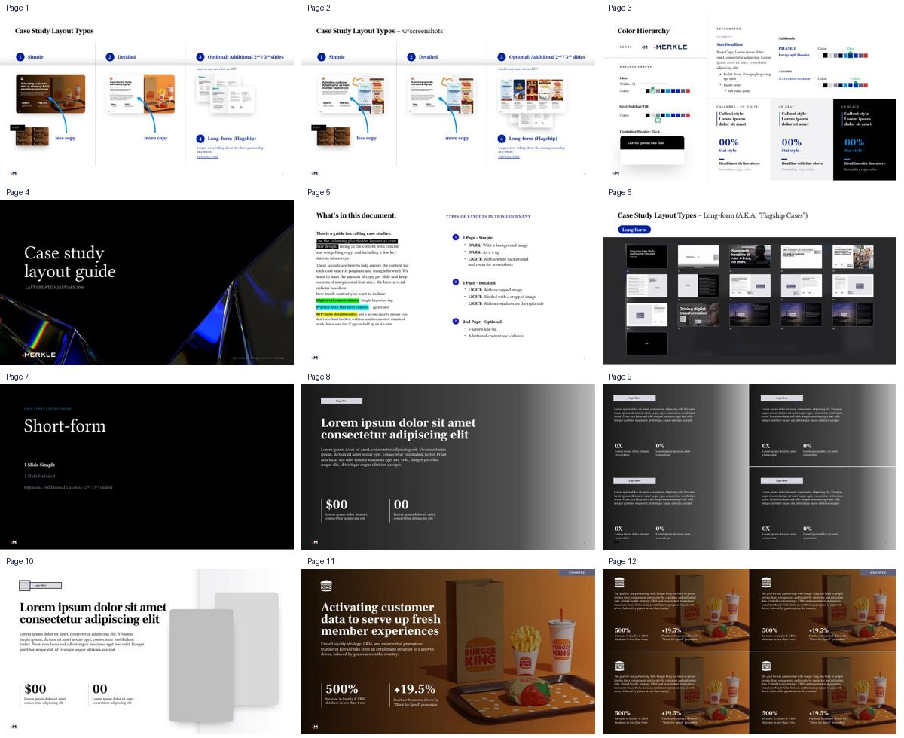
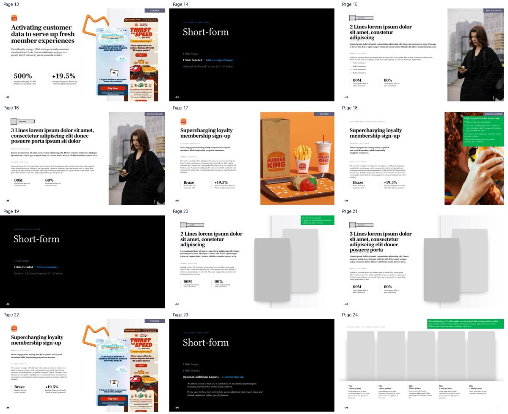
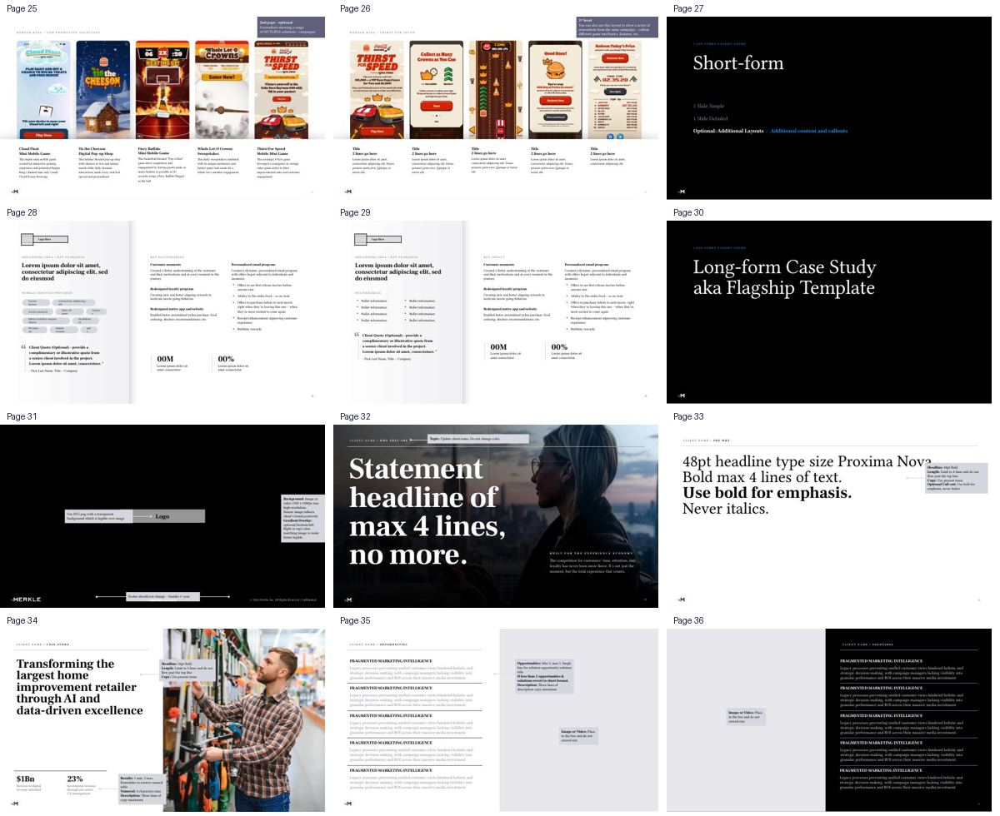
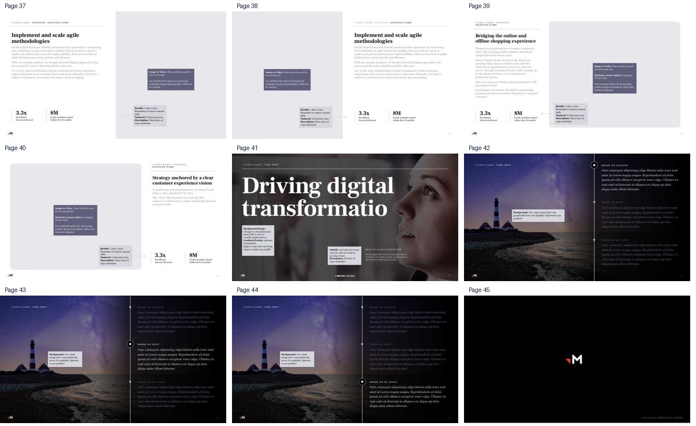

# Case Library 案例版式

> 缩略图为源 PPT 的转换预览，示例中的客户信息和数据仅供版式参考；具体素材与事实应根据当前项目核实。图片可点击放大。

GitHub 可直接查看目录及预览，交互式离线版本请下载仓库内的 HTML 文件。

## 第 1–12 页

| ID | 页码 | 名称 | 结构与适用场景 |
|---|---:|---|---|
| CASE-001 | 1 | 短案例版式总览 | 由简版、详版、扩展页和旗舰案例组成的选版流程；选择短案例深度、快速比较案例结构 |
| CASE-002 | 2 | 截图类案例版式总览 | 对照简版、详版及截图扩展页，展示长篇入口；产品截图较多、比较截图展示方案 |
| CASE-003 | 3 | 配色与元素说明（隐藏页） | 颜色层级、文字、线条、标识和数字强调的视觉规范；理解源文件样式、复核色彩层次 |
| CASE-004 | 4 | 案例版式指南封面 | 黑色封面配品牌抽象视觉及指南标题；文档封面、识别来源版本 |
| CASE-005 | 5 | 案例内容选择指南 | 左侧说明叙事原则，右侧列出简版、详版与扩展页类型；决定内容深度、规划案例页数 |
| CASE-006 | 6 | 旗舰案例长篇结构总览 | 缩略图并列展示旗舰案例从引入、方案到总结的页面序列；规划多页客户合作故事、选择章节 |
| CASE-007 | 7 | 短案例章节导航 | 黑底大标题列出单页简版、单页详版及附加页；组织案例版式指南、区分短案例部分 |
| CASE-008 | 8 | 深色背景单案例摘要 | 深色大幅背景图上放标题、简短叙述和两项数字；高层快速介绍、单案例核心成果 |
| CASE-009 | 9 | 四宫格案例速览 | 深色背景分成四个案例区域，每区含标识、摘要和数字；多案例横向速览、能力凭证汇总 |
| CASE-010 | 10 | 白底截图单案例摘要 | 左侧标题、说明与两项数字，右侧层叠截图占位；简要介绍数字产品、展示成果截图 |
| CASE-011 | 11 | 深色背景案例示例 | 客户品牌背景图上叠加案例标题、简介与两项指标；理解深色案例如何结合品牌图、高层摘要 |
| CASE-012 | 12 | 四宫格案例示例 | 四个深色案例块分别呈现摘要与指标；理解四宫格的密度、多案例速览 |

## 第 13–24 页

| ID | 页码 | 名称 | 结构与适用场景 |
|---|---:|---|---|
| CASE-013 | 13 | 白底截图案例示例 | 左侧故事和两项成果，右侧两张移动端案例截图；数字营销成果展示、产品体验案例摘要 |
| CASE-014 | 14 | 详版案例：图片型章节 | 黑底章节页提示单页详版及裁切图片选项；查找图片型单页详版 |
| CASE-015 | 15 | 两行标题与右侧裁切图片 | 左侧标题、业务挑战、解决方案及两项成果，右侧竖幅图片；单页完整案例、业务问题与方案结果 |
| CASE-016 | 16 | 三行标题与右侧裁切图片 | 长标题占据更多纵向空间，下方压缩挑战与方案，右侧图片；标题较长、案例信息需单页呈现 |
| CASE-017 | 17 | 图片型单案例示例 | 客户标识、挑战、解决方案和成果与右侧品牌图并列；检视已填充的图片案例结构 |
| CASE-018 | 18 | 匿名客户案例示例 | 行业标签替代客户标识，标题、挑战、方案和图片位置基本不变；客户名称需匿名、保密案例叙事 |
| CASE-019 | 19 | 详版案例：截图型章节 | 黑底章节页标识截图型单页详版；查找产品截图配合案例叙事的模板 |
| CASE-020 | 20 | 两行标题与右侧截图 | 左侧业务挑战、方案和成果；右侧叠放截图；单页数字化案例、同时说明背景和界面成果 |
| CASE-021 | 21 | 三行标题与右侧截图 | 较长标题、挑战与方案文本配右侧移动界面截图；标题较长的产品案例、解决方案展示 |
| CASE-022 | 22 | 截图型单案例示例 | 左侧实际案例叙事和指标，右侧产品截图；了解截图与案例正文的组合 |
| CASE-023 | 23 | 五屏扩展页使用说明 | 黑底章节页解释为何使用附加截图页及说明文字；截图较多、解释各界面功能 |
| CASE-024 | 24 | 五屏截图与逐项说明 | 顶部客户与方案眉题，下方并列五张竖向截图及对应标题说明；移动产品功能拆解、多触点展示 |

## 第 25–36 页

| ID | 页码 | 名称 | 结构与适用场景 |
|---|---:|---|---|
| CASE-025 | 25 | 多个活动并列示例 | 五个并列截图分别对应不同解决方案或活动，并附短说明；同一客户的多项活动、不同交付物组合 |
| CASE-026 | 26 | 单活动多步骤示例 | 同一活动的多张截图横向排列，逐项解释不同功能或机制；展示一个活动的用户路径、界面功能拆解 |
| CASE-027 | 27 | 补充内容与重点说明章节 | 黑底标题页引出附加内容和重点说明两种扩展布局；需要补充交付或洞察、寻找第二页结构 |
| CASE-028 | 28 | 核心理念、服务与交付 | 左侧核心想法及服务标签、引用；右侧逐项说明交付内容并辅以指标；解释做法与交付、补充案例关键学习 |
| CASE-029 | 29 | 交付与影响补充说明 | 左侧核心理念、服务与引用；右侧并列交付物和关键影响，底部成果指标；说明方案产出与影响、详细能力凭证 |
| CASE-030 | 30 | 旗舰案例章节页 | 黑底大标题引入长篇旗舰案例模板；多页深度案例章节 |
| CASE-031 | 31 | 品牌影像开场页 | 全幅背景图或视频与客户标识、品牌标识及页脚；旗舰案例开场、建立客户品牌背景 |
| CASE-032 | 32 | 客户背景与核心陈述 | 大背景图上叠加简短大标题和客户介绍；介绍客户及行业语境、提出案例主题 |
| CASE-033 | 33 | 品牌原因与陈述标题 | 白底大字陈述，顶部客户名称和 THE WHY 眉题；解释为什么开展项目、强调核心判断 |
| CASE-034 | 34 | 案例摘要与指标 | 左侧项目主题和关键指标，右侧大图及案例概述；在进入详细过程前概览案例、客户背景和总体目标 |
| CASE-035 | 35 | 多项方案清单：文字在左 | 左侧纵向列出多个解决方案及说明，右侧放大幅图片或视频；概览多个工作流、介绍方案组合 |
| CASE-036 | 36 | 多项方案清单：深色文字在右 | 左侧图片或视频，右侧深色背景排列多项解决方案；方案组合的左右镜像布局、多章节案例 |

## 第 37–45 页

| ID | 页码 | 名称 | 结构与适用场景 |
|---|---:|---|---|
| CASE-037 | 37 | 单项方案：图像在右 | 左侧方案标题、说明和成果数字，右侧全幅裁切视觉；深入说明单一工作流、方案与结果 |
| CASE-038 | 38 | 单项方案：图像在左 | 左侧全幅裁切视觉，右侧方案标题、说明和成果数字；单项方案详解、长案例内交替版式 |
| CASE-039 | 39 | 单项方案：完整截图在右 | 左侧标题、背景、做法及指标，右侧容器完整展示产品图；产品设计、界面截图、技术图解 |
| CASE-040 | 40 | 单项方案：完整截图在左 | 左侧容器视觉，右侧方案标题、说明和指标；单方案图文详解、交替展示截图 |
| CASE-041 | 41 | 关键结论与成果叠图 | 背景图片上放大标题及多个短结论说明；提炼项目总体价值、长篇案例收束 |
| CASE-042 | 42 | 分步总结：第一步 | 全幅背景与侧栏，强调第一项结论并弱化后续项；分步讲述项目成果、逐项展开三条结论 |
| CASE-043 | 43 | 分步总结：第二步 | 保持背景和侧栏结构，突出第二项结论；逐步呈现多项成果、第二个要点 |
| CASE-044 | 44 | 分步总结：第三步 | 保持背景和侧栏结构，突出第三项结论；逐步呈现多项成果、第三个要点 |
| CASE-045 | 45 | 品牌结束页 | 黑色背景中央为 M 标识；旗舰案例收尾、章节结束 |

