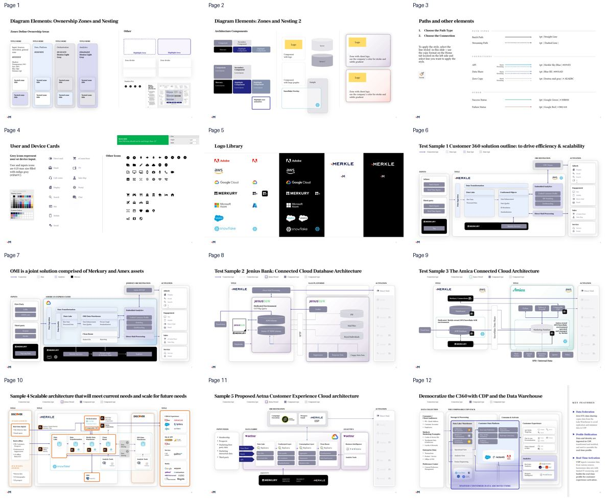
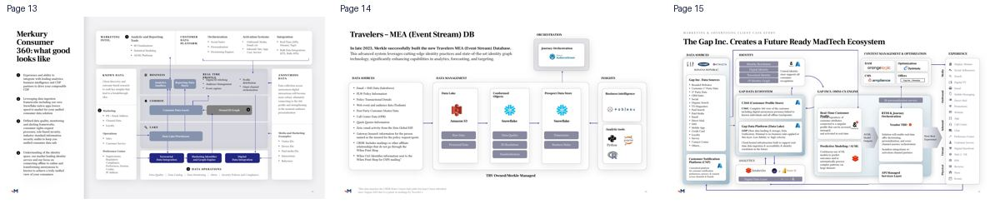

# Diagram Library 图形与架构

> 缩略图为源 PPT 的转换预览，示例中的客户信息和数据仅供版式参考；具体素材与事实应根据当前项目核实。图片可点击放大。

GitHub 可直接查看目录及预览，交互式离线版本请下载仓库内的 HTML 文件。

## 第 1–12 页

| ID | 页码 | 名称 | 结构与适用场景 |
|---|---:|---|---|
| DIA-001 | 1 | 区域容器：输入与通用边界 | 主体为白底圆角纵向容器，标题在外顶部，内部可嵌套子区域。；一般输入、数据来源、激活区域、所有权边界 |
| DIA-002 | 1 | 数据与平台区域 | 浅蓝色圆角父容器内纵向放置多个子容器，顶部独立区域标题。；数据湖、平台、处理区域、数据资产边界 |
| DIA-003 | 1 | 编排与分析区域 | 灰色与淡紫色圆角区域并列，子容器分层嵌套。；旅程编排、分析层、能力分组 |
| DIA-004 | 1 | 重点高亮框 | 蓝色虚线轮廓或浅色底蓝色实线轮廓，用于框选内容范围。；重点能力、新增范围、讨论焦点 |
| DIA-005 | 1 | 区域内分隔与编号 | 容器内部水平分隔线以及圆形数字标签。；子区域分组、图文标注、图例引用 |
| DIA-006 | 2 | 组件卡片：基础与次级 | 灰紫色、浅灰色或深色的圆角矩形组件，支持短标题及可选说明。；平台组件、功能模块、步骤节点 |
| DIA-007 | 2 | 组件卡片：品牌与重点 | 黑色品牌块、深蓝高亮块与浅蓝灰高亮块并列展示。；产品能力、重点模块、品牌能力 |
| DIA-008 | 2 | 图文组件与数据库圆柱 | 图文卡片嵌入标识或图像；两种灰色圆柱表示存储类组件。；数据仓库、数据库、供应商模块、图文节点 |
| DIA-009 | 2 | 客户拥有的渐变区域 | 浅色渐变大容器叠细色边框与客户标识，内部放具体系统。；客户环境、责任边界、多方系统 |
| DIA-010 | 2 | 跨区域覆盖与高亮描边 | 浅蓝细线透明覆盖框跨过多个容器，或以粗蓝描边圈出重点。；跨平台服务、覆盖范围、突出模块 |
| DIA-011 | 3 | 批处理与流式路径 | 水平有向箭头：批处理用实线，流式用虚线。；批量数据传输、事件流、接口路径 |
| DIA-012 | 3 | 接口、数据共享与零拷贝连线 | API、Data Share 和 Zero Copy 以颜色区分，并各有实线和虚线变体。；API、数据共享、零拷贝、系统集成 |
| DIA-013 | 3 | 成功与失败状态连线 | 绿色及红色有向箭头，用于区分状态结果。；成功或失败分支、处理结果 |
| DIA-014 | 4 | 用户、设备和渠道图标 | 小尺寸灰紫色图标与文字标签成对排列，代表渠道或用户输入。；邮件、站点、社交、门店、客服、销售 |
| DIA-015 | 4 | 状态、设备及行业图标 | 右侧黑色小图标网格包含状态、设备、行业及地点等图形。；状态标记、终端、行业、交互触点 |
| DIA-016 | 5 | 平台与品牌标识变体 | 白底与黑底分别陈列平台和品牌标识的横版、小图和反白版本。；厂商标识、系统图例、深浅背景 |
| DIA-017 | 6 | 输入—数据—编排—激活的分区架构 | 左侧输入分组，中间平台内含数据摄取、湖仓和标准对象；分析在右，编排在上，品牌身份服务在下，渠道最右。；客户数据平台、端到端架构、输入到渠道 |
| DIA-018 | 7 | 客户环境与身份服务双层架构 | 在上部客户云环境中放数据、清洁室和分析，下方独立深色身份平台；左输入右渠道，上方编排。；多方平台协作、所有权分界、数据共享架构 |
| DIA-019 | 8 | 专属环境与 SaaS 数据库连接 | 左侧专属环境含数据库圆柱，右侧 SaaS 环境含多个数据对象，中间窄竖条表示传输边界，右侧激活。；数据库部署、专属环境、跨平台文件传输 |
| DIA-020 | 9 | 双环境数据共享架构 | 左侧服务方与右侧客户环境并列，中间共享通道，底部来源和顶部工具连接数据库。；数据共享、双环境架构、客户自有数据 |
| DIA-021 | 10 | 多来源湖仓与渠道生态 | 左数据来源、中部湖仓与身份编排、右客户仓库及多类渠道，横向连线跨区。；全渠道营销技术、数据仓库、多系统集成 |
| DIA-022 | 11 | 数据结构与身份编排架构 | 左输入、中部四个数据层、右分析、上编排、下身份服务，最右渠道。；数据平台分层、数据产品、身份解析、受众激活 |
| DIA-023 | 12 | 架构主体加右侧能力说明 | 左侧数据收集，中部存储处理与 CDP 激活分组，右侧独立文字说明关键能力。；架构方案解释、技术与业务读者混合、产品能力说明 |

## 第 13–15 页

| ID | 页码 | 名称 | 结构与适用场景 |
|---|---:|---|---|
| DIA-024 | 13 | 分层架构加编号叙事 | 左侧编号文字，中部三层数据架构，两侧已知与匿名数据，上部能力，下部治理。；目标架构、客户画像、架构能力解释 |
| DIA-025 | 14 | 线性数据处理链加说明 | 左侧数据来源，中部三个并列处理节点，右侧洞察，上方单独编排；标题下有背景描述。；数据流水线、处理阶段、分析与编排 |
| DIA-026 | 15 | 多能力交互与全渠道生态 | 左来源，中左身份和数据，中部画像、模型与编排，右上内容管理，右侧按类型列渠道；跨域箭头连接。；复杂营销生态、身份与内容协同、渠道架构 |

