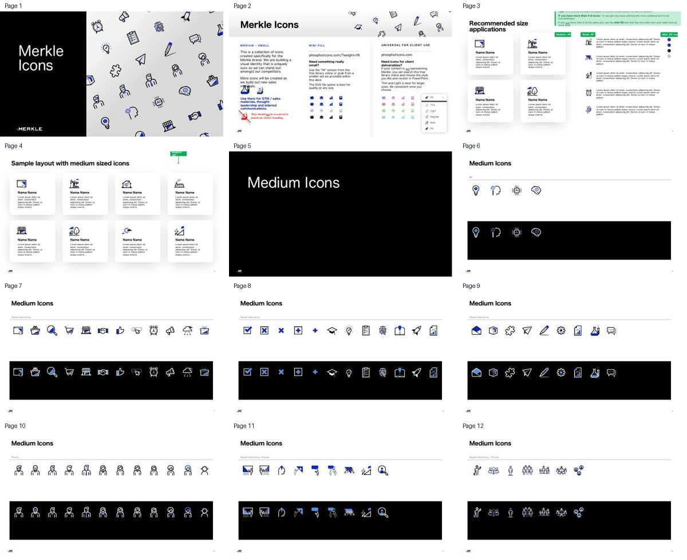
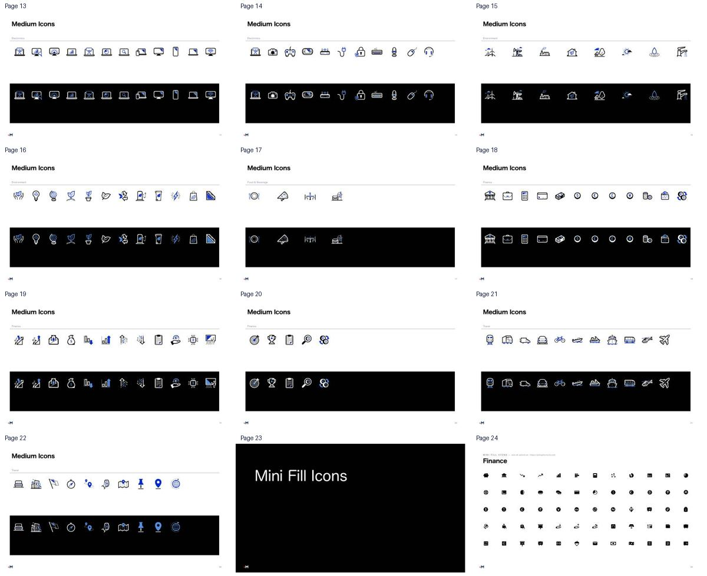
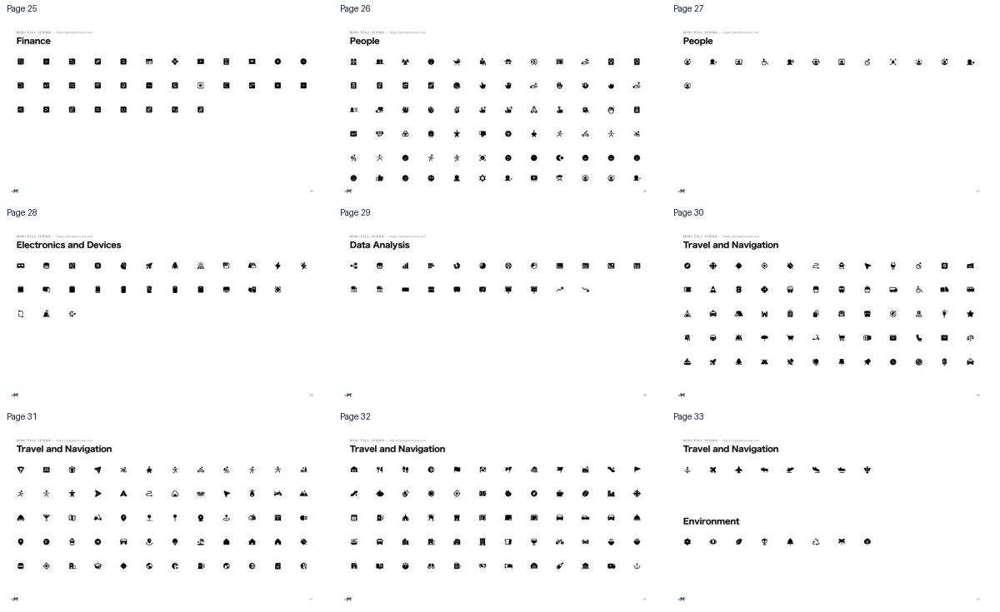

# ICON Library 图标库

> 缩略图为源 PPT 的转换预览，示例中的客户信息和数据仅供版式参考；具体素材与事实应根据当前项目核实。图片可点击放大。

Medium 和 Mini Fill 图标分组与原 PPT 一致。下方可按页面查看缩略图及每个图标的图形含义、潜在使用场景；以原 PPT 对象和 SVG 为准。

## 第 1–12 页

| ID | 页码 | 分类 | 含义与应用场景 |
|---|---:|---|---|
| P06-01 | 6 | AI | AI灯泡；AI创意;智能创新;AI机会 |
| P06-02 | 6 | AI | AI芯片与人脑侧影；人机协作;智能决策;AI辅助工作 |
| P06-03 | 6 | AI | AI芯片与电路；AI技术;机器学习;智能算力 |
| P06-04 | 6 | AI | AI芯片与大脑；认知智能;智能分析;AI模型 |
| P07-01 | 7 | Digital Marketing | 浏览器与鼠标；网站访问;网页交互;数字触点 |
| P07-02 | 7 | Digital Marketing | 购物篮；选购商品;购物体验;电商 |
| P07-03 | 7 | Digital Marketing | 放大镜；搜索;信息发现;研究 |
| P07-04 | 7 | Digital Marketing | 购物车；在线购物;订单转化;购买流程 |
| P07-05 | 7 | Digital Marketing | 店铺；线下门店;零售渠道;门店体验 |
| P07-06 | 7 | Digital Marketing | 握手；合作伙伴;协作关系;达成协议 |
| P07-07 | 7 | Digital Marketing | 点赞手势；满意;认可;正向反馈 |
| P07-08 | 7 | Digital Marketing | 鼠标点击按钮；点击行为;转化动作;交互操作 |
| P07-09 | 7 | Digital Marketing | 闹钟；时间安排;提醒;限时活动 |
| P07-10 | 7 | Digital Marketing | 扩音器；推广;广告;活动传播 |
| P07-11 | 7 | Digital Marketing | 云与连接节点；云平台;系统连接;数据集成 |
| P07-12 | 7 | Digital Marketing | 礼品盒；礼遇;奖励;客户激励 |
| P08-01 | 8 | Digital Marketing | 勾选框；任务完成;已确认;核对通过 |
| P08-02 | 8 | Digital Marketing | 方框叉号；取消;否定;未通过 |
| P08-03 | 8 | Digital Marketing | 叉号；移除;错误;关闭 |
| P08-04 | 8 | Digital Marketing | 方框加号；新增;添加项目;扩展 |
| P08-05 | 8 | Digital Marketing | 加号；增加;正向变化;新增 |
| P08-06 | 8 | Digital Marketing | 学位帽；培训;教育;能力建设 |
| P08-07 | 8 | Digital Marketing | 灯泡与勾；经过验证的想法;方案确认;创新 |
| P08-08 | 8 | Digital Marketing | 清单夹板；任务清单;检查项目;评估 |
| P08-09 | 8 | Digital Marketing | 指纹；身份识别;个性化;安全验证 |
| P08-10 | 8 | Digital Marketing | 书本与灯泡；知识学习;研究洞察;知识管理 |
| P08-11 | 8 | Digital Marketing | 火箭；项目启动;产品发布;增长 |
| P08-12 | 8 | Digital Marketing | 图表报告；报告;指标分析;业绩回顾 |
| P09-01 | 9 | Digital Marketing | 信封；邮件;电子邮件营销;通知 |
| P09-02 | 9 | Digital Marketing | 包裹；配送;订单履约;商品交付 |
| P09-03 | 9 | Digital Marketing | 拼图；能力整合;模块组合;解决方案 |
| P09-04 | 9 | Digital Marketing | 纸飞机；发送;消息投递;沟通 |
| P09-05 | 9 | Digital Marketing | 铅笔；编辑;内容创作;记录 |
| P09-06 | 9 | Digital Marketing | 齿轮；设置;运营流程;技术配置 |
| P09-07 | 9 | Digital Marketing | 图表报告；报告;业绩分析;数据结果 |
| P09-08 | 9 | Digital Marketing | 实验烧瓶；实验;测试;创新研究 |
| P09-09 | 9 | Digital Marketing | 对话气泡；对话;客户反馈;沟通渠道 |
| P10-01 | 10 | People | 人物头像一；人员画像;用户代表;客户类型 |
| P10-02 | 10 | People | 人物头像二；人员画像;用户代表;角色 |
| P10-03 | 10 | People | 人物头像三；人员画像;专业角色;客户分群 |
| P10-04 | 10 | People | 人物头像四；人员画像;用户代表;受众 |
| P10-05 | 10 | People | 西装人物头像；职场角色;业务负责人;专业人员 |
| P10-06 | 10 | People | 人物头像六；人员画像;业务角色;客户代表 |
| P10-07 | 10 | People | 人物头像七；人员画像;用户代表;受众 |
| P10-08 | 10 | People | 人物头像八；人员画像;用户代表;客户类型 |
| P10-09 | 10 | People | 人物头像九；人员画像;用户代表;角色 |
| P10-10 | 10 | People | 人物头像十；人员画像;用户代表;受众 |
| P10-11 | 10 | People | 人物头像十一；人员画像;用户代表;客户类型 |
| P10-12 | 10 | People | 耳麦服务人员；客服;客户支持;联络中心 |
| P11-01 | 11 | Digital Marketing- People | 讲师与屏幕；培训;演示;工作坊 |
| P11-02 | 11 | Digital Marketing- People | 讲师与增长图表；业绩汇报;增长培训;分析演示 |
| P11-03 | 11 | Digital Marketing- People | 人头与灯泡；思考;创意;洞察 |
| P11-04 | 11 | Digital Marketing- People | 人员协助上台阶；支持;辅导;互助 |
| P11-05 | 11 | Digital Marketing- People | 人员与对话框；发言;提出问题;客户反馈 |
| P11-06 | 11 | Digital Marketing- People | 两人对话；沟通;访谈;协商 |
| P11-07 | 11 | Digital Marketing- People | 团队击掌；团队合作;共同成功;协作 |
| P11-08 | 11 | Digital Marketing- People | 人物攀登旗帜；目标;挑战;职业成长 |
| P11-09 | 11 | Digital Marketing- People | 人物放大镜；用户研究;客户识别;受众分析 |
| P12-01 | 12 | Digital Marketing – People | 行李人物挥手；旅客;出行服务;旅行 |
| P12-02 | 12 | Digital Marketing – People | 三人团队；团队;客户群;员工群体 |
| P12-03 | 12 | Digital Marketing – People | 单个人物；个人用户;员工;客户 |
| P12-04 | 12 | Digital Marketing – People | 多人人群；受众;人群细分;社区 |
| P12-05 | 12 | Digital Marketing – People | 家庭；家庭客户;家庭结构;生命周期 |
| P12-06 | 12 | Digital Marketing – People | 多人围桌；团队会议;共创工作坊;协作 |
| P12-07 | 12 | Digital Marketing – People | 三个人互联；关系网络;多方连接;社群 |

## 第 13–24 页

| ID | 页码 | 分类 | 含义与应用场景 |
|---|---:|---|---|
| P13-01 | 13 | Electronics | 电脑与聊天窗口；在线客服;消息沟通;数字服务 |
| P13-02 | 13 | Electronics | 屏幕图表与放大镜；数据分析;指标诊断;报告审查 |
| P13-03 | 13 | Electronics | 屏幕与齿轮；系统设置;自动化;技术运营 |
| P13-04 | 13 | Electronics | 电脑与增长图表；业务增长;数据看板;绩效趋势 |
| P13-05 | 13 | Electronics | 电脑与消息框；客户对话;在线支持;消息触点 |
| P13-06 | 13 | Electronics | 电脑与饼图；数据分析;渠道构成;比例 |
| P13-07 | 13 | Electronics | 电脑与放大镜；在线搜索;数字调研;信息查找 |
| P13-08 | 13 | Electronics | 手机与平板；跨设备体验;移动端;响应式设计 |
| P13-09 | 13 | Electronics | 桌面显示器；桌面端;数字平台;工作站 |
| P13-10 | 13 | Electronics | 智能手机；移动端;手机应用;移动触点 |
| P13-11 | 13 | Electronics | 笔记本电脑；工作设备;在线工作;数字工具 |
| P13-12 | 13 | Electronics | 屏幕与无线信号；网络连接;数字渠道;无线服务 |
| P14-01 | 14 | Electronics | 电脑与聊天窗口；在线客服;数字对话;消息触点 |
| P14-02 | 14 | Electronics | 相机；摄影;图片内容;视觉素材 |
| P14-03 | 14 | Electronics | 游戏手柄；游戏;互动娱乐;游戏体验 |
| P14-04 | 14 | Electronics | 掌机；游戏设备;移动游戏;娱乐 |
| P14-05 | 14 | Electronics | 路由器；网络连接;家庭网络;无线基础设施 |
| P14-06 | 14 | Electronics | 电源插头；电力;接入;设备连接 |
| P14-07 | 14 | Electronics | 锁与盾牌；信息安全;数据保护;访问控制 |
| P14-08 | 14 | Electronics | 键盘；输入;办公设备;文本输入 |
| P14-09 | 14 | Electronics | 麦克风；语音输入;音频内容;播客 |
| P14-10 | 14 | Electronics | 鼠标；数字操作;电脑交互;点击 |
| P14-11 | 14 | Electronics | 耳麦；客服;音频;远程沟通 |
| P15-01 | 15 | Environment | 风力发电机；风能;可再生能源;低碳电力 |
| P15-02 | 15 | Environment | 石油钻井机；石油;传统能源;能源生产 |
| P15-03 | 15 | Environment | 工厂与排放；工业排放;制造业;环境影响 |
| P15-04 | 15 | Environment | 绿色房屋；绿色建筑;居住环境;节能 |
| P15-05 | 15 | Environment | 树木与景观；生态环境;自然;户外 |
| P15-06 | 15 | Environment | 太阳与云；天气;气候;自然条件 |
| P15-07 | 15 | Environment | 水滴与水面；水资源;用水;水环境 |
| P15-08 | 15 | Environment | 水龙头；供水;用水管理;节水 |
| P16-01 | 16 | Environment | 双手托叶；环保行动;自然保护;可持续发展 |
| P16-02 | 16 | Environment | 循环灯泡；节能;绿色创新;循环经济 |
| P16-03 | 16 | Environment | 地球仪；全球;国际市场;全球环境 |
| P16-04 | 16 | Environment | 幼苗生长；可持续增长;生长;早期培育 |
| P16-05 | 16 | Environment | 盆栽；植物;培育;绿色空间 |
| P16-06 | 16 | Environment | 叶片；生态;环境友好;自然 |
| P16-07 | 16 | Environment | 循环与叶片；回收;循环利用;循环经济 |
| P16-08 | 16 | Environment | 绿色加油泵；替代燃料;绿色能源;交通能源 |
| P16-09 | 16 | Environment | 回收垃圾桶；垃圾分类;废弃物管理;回收 |
| P16-10 | 16 | Environment | 闪电；电力;能源;速度 |
| P16-11 | 16 | Environment | 环保购物袋；可持续消费;零售包装;环保采购 |
| P16-12 | 16 | Environment | 太阳能板；太阳能;可再生能源;清洁电力 |
| P17-01 | 17 | Food & Beverage | 餐盘与餐具；餐饮;用餐;食品服务 |
| P17-02 | 17 | Food & Beverage | 披萨；食品;快餐;餐饮选择 |
| P17-03 | 17 | Food & Beverage | 餐桌；餐厅;堂食;就餐体验 |
| P17-04 | 17 | Food & Beverage | 汉堡与饮料；快餐;食品饮料;餐饮 |
| P18-01 | 18 | Finance | 银行建筑；银行;金融机构;金融服务 |
| P18-02 | 18 | Finance | 公文包；商务;企业客户;专业服务 |
| P18-03 | 18 | Finance | 计算器；计算;预算;成本估算 |
| P18-04 | 18 | Finance | 银行卡；支付;信用卡;消费 |
| P18-05 | 18 | Finance | 一叠纸币；现金;资金;收入 |
| P18-06 | 18 | Finance | 美元；美元;收入;美元计价 |
| P18-07 | 18 | Finance | 欧元；欧元;欧洲货币;欧元计价 |
| P18-08 | 18 | Finance | 英镑；英镑;英国货币;英镑计价 |
| P18-09 | 18 | Finance | 日元人民币符号；日元;人民币;亚洲货币 |
| P18-10 | 18 | Finance | 硬币与美元；资金;储蓄;收入 |
| P18-11 | 18 | Finance | 数字货币钱包；数字钱包;加密资产;支付 |
| P18-12 | 18 | Finance | 欧元美元兑换；汇率;货币兑换;跨境支付 |
| P19-01 | 19 | Finance | 攀登与货币箭头；业绩增长;营收目标;增长挑战 |
| P19-02 | 19 | Finance | 攀登与上升箭头；增长目标;进步;绩效提升 |
| P19-03 | 19 | Finance | 信封与钱币；支付通知;账单邮件;财务沟通 |
| P19-04 | 19 | Finance | 钱袋；资金;预算;收入 |
| P19-05 | 19 | Finance | 柱状图向下；下降趋势;业绩回落;成本下降 |
| P19-06 | 19 | Finance | 柱状图向上；增长趋势;业绩上升;指标提升 |
| P19-07 | 19 | Finance | 货币向上箭头；收入增加;价格上涨;资金流入 |
| P19-08 | 19 | Finance | 货币向下箭头；支出;成本下降;收入回落 |
| P19-09 | 19 | Finance | 夹板报告；财务清单;核对;报告 |
| P19-10 | 19 | Finance | 手托硬币；资金支持;投资;支付 |
| P19-11 | 19 | Finance | 区块链芯片；数字货币;区块链技术;加密资产 |
| P19-12 | 19 | Finance | 讲师与屏幕；培训;财务演示;业务汇报 |
| P20-01 | 20 | Finance | 靶心与箭；目标;精准定位;绩效目标 |
| P20-02 | 20 | Finance | 奖杯；成果;获奖;认可 |
| P20-03 | 20 | Finance | 夹板文档；文件清单;审计;检查 |
| P20-04 | 20 | Finance | 放大镜与货币；财务审查;成本分析;投资调研 |
| P20-05 | 20 | Finance | 欧元美元兑换；货币兑换;国际支付;汇率 |
| P21-01 | 21 | Travel | 火车；铁路;公共交通;通勤 |
| P21-02 | 21 | Travel | 货运卡车；货运;配送;物流 |
| P21-03 | 21 | Travel | 快速货车；快速配送;履约;运输 |
| P21-04 | 21 | Travel | 汽车；汽车出行;交通;乘车 |
| P21-05 | 21 | Travel | 自行车；骑行;低碳出行;城市交通 |
| P21-06 | 21 | Travel | 快艇；水上出行;游艇;休闲 |
| P21-07 | 21 | Travel | 客船；水路交通;渡轮;旅行 |
| P21-08 | 21 | Travel | 轮船；海运;远洋旅行;航运 |
| P21-09 | 21 | Travel | 公交车；公共交通;公交服务;城市出行 |
| P21-10 | 21 | Travel | 直升机；航空;空中救援;交通运输 |
| P21-11 | 21 | Travel | 飞机；航空旅行;航班;出差 |
| P22-01 | 22 | Travel | 床；酒店;住宿;休息 |
| P22-02 | 22 | Travel | 楼宇与货币放大镜；酒店价格;住宿搜索;费用比较 |
| P22-03 | 22 | Travel | 旗帜；目的地;里程碑;目标 |
| P22-04 | 22 | Travel | 指南针；方向;导航;探索 |
| P22-05 | 22 | Travel | 多个定位点；多地点;路线;网点分布 |
| P22-06 | 22 | Travel | 手机与定位；移动导航;定位服务;地图应用 |
| P22-07 | 22 | Travel | 地图与定位标记；地图;地址;目的地 |
| P22-08 | 22 | Travel | 图钉；标记地点;重点标注;位置 |
| P22-09 | 22 | Travel | 定位标记；地点;地址;线下网点 |
| P22-10 | 22 | Travel | 地球；全球;跨区域;国际旅行 |
| P24-01 | 24 | Finance | piggy-bank；储蓄;存钱;资金管理;资金;现金;支付;银行;金融机构 |
| P24-02 | 24 | Finance | bank；资金;现金;支付;银行;金融机构 |
| P24-03 | 24 | Finance | trend-down；下降;跌幅;负增长 |
| P24-04 | 24 | Finance | trend-up；增长;上升;趋势 |
| P24-05 | 24 | Finance | chart-bar；柱状图;数据比较;绩效分析 |
| P24-06 | 24 | Finance | chart-bar-horizontal；横向柱状图;对比;数据分析;柱状图;数据比较;绩效分析 |
| P24-07 | 24 | Finance | calculator；计算;预算;估算;除法;数学;比例 |
| P24-08 | 24 | Finance | strategy；策略;战术;路径;规划 |
| P24-09 | 24 | Finance | chart-donut；环形图;比例;构成 |
| P24-10 | 24 | Finance | chart-line；折线图;趋势分析 |
| P24-11 | 24 | Finance | chart-line-up；折线上升;增长趋势;折线图;趋势分析 |
| P24-12 | 24 | Finance | chart-pie-slice；饼图;份额;占比;构成 |
| P24-13 | 24 | Finance | chart-polar；极坐标;数据分析 |
| P24-14 | 24 | Finance | chart-scatter；散点图;分布;相关性 |
| P24-15 | 24 | Finance | coin-vertical；货币;汇率;支付;资金;现金;硬币;零钱 |
| P24-16 | 24 | Finance | coin；货币;汇率;支付;资金;现金;硬币;零钱 |
| P24-17 | 24 | Finance | coins；货币;汇率;支付;资金;现金 |
| P24-18 | 24 | Finance | credit-card；信用卡;银行卡;支付;资金;现金 |
| P24-19 | 24 | Finance | chart-pie；饼图;占比;构成 |
| P24-20 | 24 | Finance | currency-circle-dollar；货币;汇率;支付;资金;现金 |
| P24-21 | 24 | Finance | currency-eur；欧元;欧洲货币;欧元计价;货币;汇率;支付;资金;现金 |
| P24-22 | 24 | Finance | currency-btc；比特币;加密资产;数字货币;货币;汇率;支付;资金;现金 |
| P24-23 | 24 | Finance | currency-kzt；货币;汇率;支付;资金;现金 |
| P24-24 | 24 | Finance | currency-cny；人民币;中国货币;人民币计价;货币;汇率;支付;资金;现金 |
| P24-25 | 24 | Finance | currency-dollar；美元;美国货币;美元计价;货币;汇率;支付;资金;现金 |
| P24-26 | 24 | Finance | currency-dollar-simple；美元符号;金额;美元计价;美元;美国货币;货币;汇率;支付;资金;现金 |
| P24-27 | 24 | Finance | currency-gbp；英镑;英国货币;英镑计价;货币;汇率;支付;资金;现金 |
| P24-28 | 24 | Finance | currency-inr；印度卢比;印度货币;卢比计价;货币;汇率;支付;资金;现金 |
| P24-29 | 24 | Finance | currency-jpy；日元;日本货币;日元计价;货币;汇率;支付;资金;现金 |
| P24-30 | 24 | Finance | currency-krw；韩元;韩国货币;韩元计价;货币;汇率;支付;资金;现金 |
| P24-31 | 24 | Finance | empty；计算;预算;估算 |
| P24-32 | 24 | Finance | currency-ngn；货币;汇率;支付;资金;现金 |
| P24-33 | 24 | Finance | currency-eth；以太坊;加密资产;数字货币;货币;汇率;支付;资金;现金 |
| P24-34 | 24 | Finance | presentation-chart；汇报;演示;数据图表;演讲 |
| P24-35 | 24 | Finance | currency-rub；货币;汇率;支付;资金;现金 |
| P24-36 | 24 | Finance | tip-jar；资金;现金;支付 |
| P24-37 | 24 | Finance | paypal-logo；PayPal;在线支付 |
| P24-38 | 24 | Finance | hand-deposit；存款;现金存入;资金转入;手势;操作;触摸;支持 |
| P24-39 | 24 | Finance | hand-withdraw；取款;现金支取;资金转出;手势;操作;触摸;支持 |
| P24-40 | 24 | Finance | projector-screen；投影;演示;会议;汇报;演讲 |
| P24-41 | 24 | Finance | hand-arrow-down；手与向下箭头;领取;资金流入;手势;操作;触摸;支持 |
| P24-42 | 24 | Finance | hand-arrow-up；手与向上箭头;提交;资金流出;手势;操作;触摸;支持 |
| P24-43 | 24 | Finance | hand-coins；手托硬币;支付;资金支持;资金;现金;手势;操作;触摸;支持 |
| P24-44 | 24 | Finance | intersection；计算;预算;估算 |
| P24-45 | 24 | Finance | lectern；汇报;演示;演讲 |
| P24-46 | 24 | Finance | invoice；发票;账单;付款;收据;报销;订单 |
| P24-47 | 24 | Finance | wallet；钱包;支付;财务;资金;现金 |
| P24-48 | 24 | Finance | presentation；汇报;演示;演讲 |
| P24-49 | 24 | Finance | math-operations；计算;预算;估算;除法;数学;比例;运算 |
| P24-50 | 24 | Finance | member-of；计算;预算;估算 |
| P24-51 | 24 | Finance | projector-screen-chart；投影;演示;图表;会议;汇报;演讲 |
| P24-52 | 24 | Finance | presentation-chart；汇报;演示;数据图表;演讲 |
| P24-53 | 24 | Finance | infinity；计算;预算;估算;无限;持续;循环 |
| P24-54 | 24 | Finance | acorn；食品;饮食;餐饮 |
| P24-55 | 24 | Finance | cardholder；钱包;支付;财务;资金;现金 |
| P24-56 | 24 | Finance | money；资金;现金;支付 |
| P24-57 | 24 | Finance | money-wavy；资金;现金;支付 |
| P24-58 | 24 | Finance | less-than-or-equal；计算;预算;估算;小于;比较;限制;等于 |
| P24-59 | 24 | Finance | greater-than-or-equal；大于;比较;阈值;计算;预算;估算;等于 |
| P24-60 | 24 | Finance | vault；银行;金融机构 |

## 第 25–33 页

| ID | 页码 | 分类 | 含义与应用场景 |
|---|---:|---|---|
| P25-01 | 25 | Finance | percent；计算;预算;估算;百分比;比例;增长率 |
| P25-02 | 25 | Finance | divide；计算;预算;估算;除法;数学;比例 |
| P25-03 | 25 | Finance | plus-minus；计算;预算;估算;减少;移除;负值;增加;新增;正值 |
| P25-04 | 25 | Finance | not-equals；计算;预算;估算 |
| P25-05 | 25 | Finance | stripe-logo；Stripe;支付平台 |
| P25-06 | 25 | Finance | table；表格;数据;信息整理 |
| P25-07 | 25 | Finance | pix-logo；Pix;支付方式 |
| P25-08 | 25 | Finance | receipt-x；收据;报销;订单;资金;现金;支付 |
| P25-09 | 25 | Finance | sigma；求和;统计;数学 |
| P25-10 | 25 | Finance | receipt；收据;报销;订单;资金;现金;支付 |
| P25-11 | 25 | Finance | plus-circle；计算;预算;估算;增加;新增;正值 |
| P25-12 | 25 | Finance | minus-circle；计算;预算;估算;减少;移除;负值 |
| P25-13 | 25 | Finance | superset-proper-of；计算;预算;估算 |
| P25-14 | 25 | Finance | text-superscript；计算;预算;估算 |
| P25-15 | 25 | Finance | approximate-equals；近似;估算;计算;预算 |
| P25-16 | 25 | Finance | pi；圆周率;数学 |
| P25-17 | 25 | Finance | superset-of；计算;预算;估算 |
| P25-18 | 25 | Finance | tilde；计算;预算;估算 |
| P25-19 | 25 | Finance | subset-of；计算;预算;估算 |
| P25-20 | 25 | Finance | square-logo；Square;支付品牌 |
| P25-21 | 25 | Finance | subset-proper-of；计算;预算;估算 |
| P25-22 | 25 | Finance | radical；计算;预算;估算 |
| P25-23 | 25 | Finance | plus-square；计算;预算;估算;增加;新增;正值 |
| P25-24 | 25 | Finance | minus-square；计算;预算;估算;减少;移除;负值 |
| P25-25 | 25 | Finance | less-than；计算;预算;估算;小于;比较;限制 |
| P25-26 | 25 | Finance | greater-than；大于;比较;阈值;计算;预算;估算 |
| P25-27 | 25 | Finance | not-subset-of；计算;预算;估算 |
| P25-28 | 25 | Finance | equals；计算;预算;估算 |
| P25-29 | 25 | Finance | union；计算;预算;估算 |
| P25-30 | 25 | Finance | not-member-of；计算;预算;估算 |
| P25-31 | 25 | Finance | text-subscript；计算;预算;估算 |
| P25-32 | 25 | Finance | not-superset-of；计算;预算;估算 |
| P26-01 | 26 | People | users-four；客户群;团队;用户;人员;客户;员工 |
| P26-02 | 26 | People | users；客户群;团队;用户;人员;客户;员工 |
| P26-03 | 26 | People | users-three；客户群;团队;用户;人员;客户;员工 |
| P26-04 | 26 | People | baby；婴儿;家庭;儿童 |
| P26-05 | 26 | People | baby-carriage；婴儿;家庭;儿童 |
| P26-06 | 26 | People | hand-deposit；存款;现金存入;资金转入;手势;操作;触摸;支持 |
| P26-07 | 26 | People | detective；调查;研究;侦查 |
| P26-08 | 26 | People | eyes；观察;关注;视觉 |
| P26-09 | 26 | People | chalkboard-teacher；培训;讲师;教学;黑板;演示 |
| P26-10 | 26 | People | hand-coins；手托硬币;支付;资金支持;资金;现金;手势;操作;触摸;支持 |
| P26-11 | 26 | People | gender-female；性别;身份;人群 |
| P26-12 | 26 | People | gender-neuter；性别;身份;人群 |
| P26-13 | 26 | People | gender-nonbinary；性别;身份;人群 |
| P26-14 | 26 | People | gender-intersex；性别;身份;人群 |
| P26-15 | 26 | People | gender-male；性别;身份;人群 |
| P26-16 | 26 | People | gender-transgender；性别;身份;人群 |
| P26-17 | 26 | People | smiley-melting；情绪;满意度;表情;用户反馈 |
| P26-18 | 26 | People | hand-pointing；手指指向;提示;选择;手势;操作;触摸;支持 |
| P26-19 | 26 | People | hand；手势;操作;触摸;支持 |
| P26-20 | 26 | People | hand-arrow-down；手与向下箭头;领取;资金流入;手势;操作;触摸;支持 |
| P26-21 | 26 | People | hand-eye；手势;操作;触摸;支持 |
| P26-22 | 26 | People | hand-fist；握拳;力量;手势;操作;触摸;支持 |
| P26-23 | 26 | People | hand-grabbing；抓取;握持;手势;操作;触摸;支持 |
| P26-24 | 26 | People | hand-arrow-up；手与向上箭头;提交;资金流出;手势;操作;触摸;支持 |
| P26-25 | 26 | People | user-list；人;人员;用户;客户群;团队;客户;员工 |
| P26-26 | 26 | People | hand-heart；关爱;帮助;支持;手势;操作;触摸 |
| P26-27 | 26 | People | hand-waving；挥手;问候;告别;手势;操作;触摸;支持 |
| P26-28 | 26 | People | hand-palm；手掌;停止;手势;操作;触摸;支持 |
| P26-29 | 26 | People | hand-peace；手势;和平;胜利;操作;触摸;支持 |
| P26-30 | 26 | People | hand-swipe-left；左滑;手势;移动交互;操作;触摸;支持 |
| P26-31 | 26 | People | hand-swipe-right；右滑;手势;移动交互;操作;触摸;支持 |
| P26-32 | 26 | People | hands-praying；宗教;文化 |
| P26-33 | 26 | People | hand-tap；点击;触摸;互动;手势;操作;支持 |
| P26-34 | 26 | People | hand-withdraw；取款;现金支取;资金转出;手势;操作;触摸;支持 |
| P26-35 | 26 | People | hands-clapping；鼓掌;认可;庆祝 |
| P26-36 | 26 | People | identification-badge；身份;证件;识别;用户;客户;员工;人员 |
| P26-37 | 26 | People | identification-card；身份;证件;识别;用户;客户;员工;人员 |
| P26-38 | 26 | People | handshake；握手;合作;协议 |
| P26-39 | 26 | People | intersect-three；性别;身份;人群 |
| P26-40 | 26 | People | lego-smiley；情绪;满意度;表情;用户反馈;积木;模块;拼接 |
| P26-41 | 26 | People | person-arms-spread；人;人员;用户 |
| P26-42 | 26 | People | thumbs-down；不满意;负面反馈;反对 |
| P26-43 | 26 | People | person-simple-circle；人;行动;活动;用户;人员 |
| P26-44 | 26 | People | person；人;人员;用户;客户;员工 |
| P26-45 | 26 | People | person-simple-run；人;行动;活动;用户;人员;客户;员工 |
| P26-46 | 26 | People | person-simple-bike；人;行动;活动;用户;自行车;骑行;交通;人员 |
| P26-47 | 26 | People | person-simple；人;行动;活动;用户;人员;客户;员工 |
| P26-48 | 26 | People | person-simple-swim；人;行动;活动;用户;人员 |
| P26-49 | 26 | People | person-simple-hike；人;行动;活动;用户;人员 |
| P26-50 | 26 | People | person-simple-tai-chi；人;行动;活动;用户;人员 |
| P26-51 | 26 | People | smiley；情绪;满意度;表情;用户反馈 |
| P26-52 | 26 | People | person-simple-walk；人;行动;活动;用户;人员;客户;员工 |
| P26-53 | 26 | People | person-simple-throw；人;行动;活动;用户;人员 |
| P26-54 | 26 | People | scan-smiley；情绪;满意度;表情;用户反馈;扫描;识别;感知 |
| P26-55 | 26 | People | smiley-angry；情绪;满意度;表情;用户反馈 |
| P26-56 | 26 | People | smiley-blank；情绪;满意度;表情;用户反馈 |
| P26-57 | 26 | People | star-and-crescent；宗教;文化;星标;收藏;评价 |
| P26-58 | 26 | People | smiley-meh；情绪;满意度;表情;用户反馈 |
| P26-59 | 26 | People | smiley-nervous；情绪;满意度;表情;用户反馈 |
| P26-60 | 26 | People | smiley-sad；情绪;满意度;表情;用户反馈 |
| P26-61 | 26 | People | smiley-sticker；情绪;满意度;表情;用户反馈 |
| P26-62 | 26 | People | thumbs-up；满意;正面反馈;认可 |
| P26-63 | 26 | People | smiley-wink；情绪;满意度;表情;用户反馈 |
| P26-64 | 26 | People | smiley-x-eyes；情绪;满意度;表情;用户反馈;观察;关注;视觉 |
| P26-65 | 26 | People | user；人;人员;用户;客户群;团队;客户;员工 |
| P26-66 | 26 | People | star-of-david；宗教;文化;星标;收藏;评价 |
| P26-67 | 26 | People | user-check；人;人员;用户;客户群;团队;客户;员工 |
| P26-68 | 26 | People | video；视频;媒体;远程沟通 |
| P26-69 | 26 | People | student；学生;教育;学习 |
| P26-70 | 26 | People | user-circle；人;人员;用户;客户群;团队;客户;员工 |
| P26-71 | 26 | People | user-circle-check；人;人员;用户;客户群;团队;客户;员工 |
| P26-72 | 26 | People | user-minus；人;人员;用户;客户群;团队;减少;移除;负值;客户;员工 |
| P27-01 | 27 | People | user-circle-plus；人;人员;用户;客户群;团队;客户;员工;增加;新增;正值 |
| P27-02 | 27 | People | user-plus；人;人员;用户;客户群;团队;客户;员工;增加;新增;正值 |
| P27-03 | 27 | People | user-rectangle；人;人员;用户;客户群;团队;客户;员工 |
| P27-04 | 27 | People | wheelchair；无障碍;出行;残障支持 |
| P27-05 | 27 | People | user-sound；人;人员;用户;客户群;团队;客户;员工 |
| P27-06 | 27 | People | user-switch；人;人员;用户;客户群;团队;客户;员工 |
| P27-07 | 27 | People | user-square；人;人员;用户;客户群;团队;客户;员工 |
| P27-08 | 27 | People | wheelchair-motion；无障碍;出行;残障支持 |
| P27-09 | 27 | People | user-focus；身份;证件;识别;人;人员;用户;客户;员工 |
| P27-10 | 27 | People | user-circle-dashed；人;人员;用户;客户群;团队;客户;员工 |
| P27-11 | 27 | People | user-circle-gear；人;人员;用户;客户群;团队;客户;员工 |
| P27-12 | 27 | People | user-gear；人;人员;用户;客户群;团队;客户;员工 |
| P27-13 | 27 | People | user-circle-minus；人;人员;用户;客户群;团队;减少;移除;负值;客户;员工 |
| P28-01 | 28 | Electronics and Devices | memory；内存;硬件;计算 |
| P28-02 | 28 | Electronics and Devices | database；数据库;数据存储;数据管理 |
| P28-03 | 28 | Electronics and Devices | circuitry；电路;技术;硬件 |
| P28-04 | 28 | Electronics and Devices | cpu；处理器;计算;硬件 |
| P28-05 | 28 | Electronics and Devices | head-circuit；智能;思考;科技 |
| P28-06 | 28 | Electronics and Devices | rocket-launch；启动;增长;发射 |
| P28-07 | 28 | Electronics and Devices | rocket；启动;增长;发射 |
| P28-08 | 28 | Electronics and Devices | solar-panel；太阳能;清洁能源 |
| P28-09 | 28 | Electronics and Devices | code-block；代码;开发;软件 |
| P28-10 | 28 | Electronics and Devices | solar-roof；太阳能;清洁能源 |
| P28-11 | 28 | Electronics and Devices | lightning；电力;能源;速度 |
| P28-12 | 28 | Electronics and Devices | lightning-slash；电力;能源;速度 |
| P28-13 | 28 | Electronics and Devices | device-tablet；平板;移动设备;设备;终端 |
| P28-14 | 28 | Electronics and Devices | devices；跨设备;多终端;电脑;桌面端;数字工作台 |
| P28-15 | 28 | Electronics and Devices | device-tablet-camera；平板;移动设备;设备;终端 |
| P28-16 | 28 | Electronics and Devices | device-mobile；手机;移动端;应用;设备;终端 |
| P28-17 | 28 | Electronics and Devices | device-mobile-camera；手机;移动端;应用;设备;终端 |
| P28-18 | 28 | Electronics and Devices | device-mobile-slash；手机;移动端;应用;设备;终端 |
| P28-19 | 28 | Electronics and Devices | device-mobile-speaker；手机;移动端;应用;设备;终端 |
| P28-20 | 28 | Electronics and Devices | device-tablet-speaker；平板;移动设备;设备;终端 |
| P28-21 | 28 | Electronics and Devices | desktop；电脑;桌面端;数字工作台 |
| P28-22 | 28 | Electronics and Devices | desktop-tower；电脑;桌面端;数字工作台 |
| P28-23 | 28 | Electronics and Devices | atom；原子;科学;研究 |
| P28-24 | 28 | Electronics and Devices | device-rotate；设备旋转;屏幕方向;设备;终端 |
| P28-25 | 28 | Electronics and Devices | nuclear-plant；植物;能源设施;生长 |
| P28-26 | 28 | Electronics and Devices | usb；设备;终端;USB;设备连接;接口 |
| P29-01 | 29 | Data Analysis | tree-structure；层级;结构;分类;关系;树木;生态;层级结构 |
| P29-02 | 29 | Data Analysis | database；数据库;数据存储;数据管理 |
| P29-03 | 29 | Data Analysis | chart-bar；柱状图;数据比较;绩效分析 |
| P29-04 | 29 | Data Analysis | chart-bar-horizontal；横向柱状图;对比;数据分析;柱状图;数据比较;绩效分析 |
| P29-05 | 29 | Data Analysis | chart-donut；环形图;比例;构成 |
| P29-06 | 29 | Data Analysis | chart-pie-slice；饼图;份额;占比;构成 |
| P29-07 | 29 | Data Analysis | chart-polar；极坐标;数据分析 |
| P29-08 | 29 | Data Analysis | chart-pie；饼图;占比;构成 |
| P29-09 | 29 | Data Analysis | chart-scatter；散点图;分布;相关性 |
| P29-10 | 29 | Data Analysis | chart-line；折线图;趋势分析 |
| P29-11 | 29 | Data Analysis | chart-line-up；折线上升;增长趋势;折线图;趋势分析 |
| P29-12 | 29 | Data Analysis | chart-line-down；折线下降;下滑趋势;折线图;趋势分析 |
| P29-13 | 29 | Data Analysis | file-csv；CSV;数据文件;导出 |
| P29-14 | 29 | Data Analysis | file-sql；数据库;数据存储;数据管理;SQL;数据查询 |
| P29-15 | 29 | Data Analysis | hard-drive；硬盘;存储;数据 |
| P29-16 | 29 | Data Analysis | hard-drives；多硬盘;存储设备;数据中心 |
| P29-17 | 29 | Data Analysis | presentation；汇报;演示;演讲 |
| P29-18 | 29 | Data Analysis | presentation-chart；汇报;演示;数据图表;演讲 |
| P29-19 | 29 | Data Analysis | projector-screen；投影;演示;会议;汇报;演讲 |
| P29-20 | 29 | Data Analysis | projector-screen-chart；投影;演示;图表;会议;汇报;演讲 |
| P29-21 | 29 | Data Analysis | trend-up；增长;上升;趋势 |
| P29-22 | 29 | Data Analysis | trend-down；下降;跌幅;负增长 |
| P30-01 | 30 | Travel and Navigation | compass；指南针;导航;方向 |
| P30-02 | 30 | Travel and Navigation | compass-rose；指南针;导航;方向 |
| P30-03 | 30 | Travel and Navigation | gps；位置;地点;定位;导航 |
| P30-04 | 30 | Travel and Navigation | gps-fix；位置;地点;定位;导航 |
| P30-05 | 30 | Travel and Navigation | gps-slash；位置;地点;定位;导航 |
| P30-06 | 30 | Travel and Navigation | path；路径;路线;旅程;定位;导航;位置 |
| P30-07 | 30 | Travel and Navigation | lighthouse；灯塔;导航;指引;楼群;建筑;办公地点 |
| P30-08 | 30 | Travel and Navigation | navigation-arrow；导航;方向;路径;位置;地点;指南针;定位 |
| P30-09 | 30 | Travel and Navigation | wine；食品;饮食;餐饮;葡萄酒;饮料 |
| P30-10 | 30 | Travel and Navigation | wheelchair-motion；无障碍;出行;残障支持 |
| P30-11 | 30 | Travel and Navigation | washing-machine；洗衣机;洗衣;家电 |
| P30-12 | 30 | Travel and Navigation | warehouse；仓库;库存;物流;楼群;建筑;办公地点 |
| P30-13 | 30 | Travel and Navigation | ticket；门票;票据;活动 |
| P30-14 | 30 | Travel and Navigation | traffic-cone；交通;道路;导航 |
| P30-15 | 30 | Travel and Navigation | traffic-signal；交通;道路;导航 |
| P30-16 | 30 | Travel and Navigation | traffic-sign；交通;道路;导航 |
| P30-17 | 30 | Travel and Navigation | train-regional；火车;铁路;交通 |
| P30-18 | 30 | Travel and Navigation | train-simple；火车;铁路;交通 |
| P30-19 | 30 | Travel and Navigation | train；火车;铁路;交通 |
| P30-20 | 30 | Travel and Navigation | tram；有轨电车;公共交通 |
| P30-21 | 30 | Travel and Navigation | truck；卡车;货运;物流 |
| P30-22 | 30 | Travel and Navigation | wheelchair；无障碍;出行;残障支持 |
| P30-23 | 30 | Travel and Navigation | truck-trailer；卡车;货运;物流 |
| P30-24 | 30 | Travel and Navigation | van；厢式车;配送;运输 |
| P30-25 | 30 | Travel and Navigation | tipi；帐篷;露营;户外 |
| P30-26 | 30 | Travel and Navigation | taxi；出租车;打车;出行 |
| P30-27 | 30 | Travel and Navigation | tent；帐篷;露营;户外 |
| P30-28 | 30 | Travel and Navigation | synagogue；犹太会堂;建筑;宗教;文化 |
| P30-29 | 30 | Travel and Navigation | suitcase-rolling；行李;旅行;出差 |
| P30-30 | 30 | Travel and Navigation | tea-bag；食品;饮食;餐饮;茶;饮品 |
| P30-31 | 30 | Travel and Navigation | subway；火车;铁路;交通 |
| P30-32 | 30 | Travel and Navigation | storefront；门店;零售;商铺;楼群;建筑;办公地点;购物;消费 |
| P30-33 | 30 | Travel and Navigation | target；目标;定位;靶心 |
| P30-34 | 30 | Travel and Navigation | swimming-pool；游泳池;运动;休闲 |
| P30-35 | 30 | Travel and Navigation | champagne；食品;饮食;餐饮;葡萄酒;饮料 |
| P30-36 | 30 | Travel and Navigation | star；星标;收藏;评价 |
| P30-37 | 30 | Travel and Navigation | push-pin-simple-slash；图钉;标记;位置 |
| P30-38 | 30 | Travel and Navigation | steering-wheel；方向盘;驾驶;汽车 |
| P30-39 | 30 | Travel and Navigation | siren；警报器;紧急服务;警示 |
| P30-40 | 30 | Travel and Navigation | signpost；路标;方向;选择;交通;道路;导航 |
| P30-41 | 30 | Travel and Navigation | shopping-cart-simple；购物;零售;消费 |
| P30-42 | 30 | Travel and Navigation | scooter；滑板车;出行 |
| P30-43 | 30 | Travel and Navigation | shopping-cart；购物;零售;消费 |
| P30-44 | 30 | Travel and Navigation | shipping-container；集装箱;货运;物流 |
| P30-45 | 30 | Travel and Navigation | shopping-bag-open；购物;零售;消费 |
| P30-46 | 30 | Travel and Navigation | seat；座位;乘坐;座席 |
| P30-47 | 30 | Travel and Navigation | shopping-bag；购物;零售;消费 |
| P30-48 | 30 | Travel and Navigation | scales；天平;权衡;公平 |
| P30-49 | 30 | Travel and Navigation | sailboat；帆船;航行;水上运动 |
| P30-50 | 30 | Travel and Navigation | rocket-launch；启动;增长;发射 |
| P30-51 | 30 | Travel and Navigation | rocket；启动;增长;发射 |
| P30-52 | 30 | Travel and Navigation | road-horizon；道路;前路;路线 |
| P30-53 | 30 | Travel and Navigation | push-pin-slash；图钉;标记;位置 |
| P30-54 | 30 | Travel and Navigation | globe-stand；全球;国际;地理 |
| P30-55 | 30 | Travel and Navigation | push-pin-simple；图钉;标记;位置 |
| P30-56 | 30 | Travel and Navigation | push-pin；图钉;标记;位置 |
| P30-57 | 30 | Travel and Navigation | prohibit-inset；禁止;限制;不可用 |
| P30-58 | 30 | Travel and Navigation | prohibit；禁止;限制;不可用 |
| P30-59 | 30 | Travel and Navigation | popsicle；食品;饮食;餐饮 |
| P30-60 | 30 | Travel and Navigation | police-car；汽车;出行;交通 |
| P31-01 | 31 | Travel and Navigation | pizza；披萨;食品;餐饮;饮食 |
| P31-02 | 31 | Travel and Navigation | picnic-table；表格;数据;信息整理;公园;户外;休闲 |
| P31-03 | 31 | Travel and Navigation | popcorn；食品;饮食;餐饮 |
| P31-04 | 31 | Travel and Navigation | paper-plane-tilt；纸飞机;发送;消息 |
| P31-05 | 31 | Travel and Navigation | person-simple-swim；人;行动;活动;用户;人员 |
| P31-06 | 31 | Travel and Navigation | person；人;人员;用户;客户;员工 |
| P31-07 | 31 | Travel and Navigation | person-simple-throw；人;行动;活动;用户;人员 |
| P31-08 | 31 | Travel and Navigation | person-simple-bike；人;行动;活动;用户;自行车;骑行;交通;人员 |
| P31-09 | 31 | Travel and Navigation | person-simple-hike；人;行动;活动;用户;人员 |
| P31-10 | 31 | Travel and Navigation | person-simple-walk；人;行动;活动;用户;人员;客户;员工 |
| P31-11 | 31 | Travel and Navigation | person-simple-tai-chi；人;行动;活动;用户;人员 |
| P31-12 | 31 | Travel and Navigation | park；公园;户外;休闲 |
| P31-13 | 31 | Travel and Navigation | person-simple-run；人;行动;活动;用户;人员;客户;员工 |
| P31-14 | 31 | Travel and Navigation | person-simple；人;行动;活动;用户;人员;客户;员工 |
| P31-15 | 31 | Travel and Navigation | person-arms-spread；人;人员;用户 |
| P31-16 | 31 | Travel and Navigation | paper-plane-right；纸飞机;发送;消息 |
| P31-17 | 31 | Travel and Navigation | paper-plane；纸飞机;发送;消息 |
| P31-18 | 31 | Travel and Navigation | path；路径;路线;旅程;定位;导航;位置 |
| P31-19 | 31 | Travel and Navigation | onigiri；食品;饮食;餐饮 |
| P31-20 | 31 | Travel and Navigation | orange-slice；食品;饮食;餐饮 |
| P31-21 | 31 | Travel and Navigation | navigation-arrow；导航;方向;路径;位置;地点;指南针;定位 |
| P31-22 | 31 | Travel and Navigation | moped-front；滑板车;出行;轻便摩托 |
| P31-23 | 31 | Travel and Navigation | motorcycle；摩托车;交通;出行 |
| P31-24 | 31 | Travel and Navigation | mountains；山峰;自然;户外 |
| P31-25 | 31 | Travel and Navigation | mosque；宗教;文化;清真寺;建筑 |
| P31-26 | 31 | Travel and Navigation | martini；食品;饮食;餐饮 |
| P31-27 | 31 | Travel and Navigation | map-trifold；地图;地点;区域 |
| P31-28 | 31 | Travel and Navigation | moped；滑板车;出行;轻便摩托 |
| P31-29 | 31 | Travel and Navigation | map-pin-plus；定位;地点;网点;增加;新增;正值;地图;区域 |
| P31-30 | 31 | Travel and Navigation | map-pin-simple-line；定位;地点;网点;地图;区域 |
| P31-31 | 31 | Travel and Navigation | map-pin-simple；定位;地点;网点;地图;区域 |
| P31-32 | 31 | Travel and Navigation | map-pin-line；定位;地点;网点;地图;区域 |
| P31-33 | 31 | Travel and Navigation | map-pin-simple-area；定位;地点;网点;地图;区域 |
| P31-34 | 31 | Travel and Navigation | mailbox；邮箱;邮件;收件 |
| P31-35 | 31 | Travel and Navigation | lockers；储物柜;物品存放;设施 |
| P31-36 | 31 | Travel and Navigation | headlights；车灯;照明;汽车 |
| P31-37 | 31 | Travel and Navigation | map-pin；定位;地点;网点;地图;区域 |
| P31-38 | 31 | Travel and Navigation | letter-circle-p；停车标识;停车;地点 |
| P31-39 | 31 | Travel and Navigation | lighthouse；灯塔;导航;指引;楼群;建筑;办公地点 |
| P31-40 | 31 | Travel and Navigation | letter-circle-h；H 标识;地点;标记;医院;医疗;健康 |
| P31-41 | 31 | Travel and Navigation | jeep；吉普车;越野;出行 |
| P31-42 | 31 | Travel and Navigation | map-pin-area；定位;地点;网点;地图;区域 |
| P31-43 | 31 | Travel and Navigation | ice-cream；食品;饮食;餐饮 |
| P31-44 | 31 | Travel and Navigation | island；岛屿;旅行;度假 |
| P31-45 | 31 | Travel and Navigation | house-simple；楼群;建筑;办公地点;房屋;居住;家庭 |
| P31-46 | 31 | Travel and Navigation | house-line；楼群;建筑;办公地点;房屋;居住;家庭 |
| P31-47 | 31 | Travel and Navigation | house；楼群;建筑;办公地点;房屋;居住;家庭 |
| P31-48 | 31 | Travel and Navigation | gps-slash；位置;地点;定位;导航 |
| P31-49 | 31 | Travel and Navigation | hamburger；汉堡;快餐;食品;饮食;餐饮 |
| P31-50 | 31 | Travel and Navigation | gps-fix；位置;地点;定位;导航 |
| P31-51 | 31 | Travel and Navigation | hospital；楼群;建筑;办公地点;医院;医疗;健康 |
| P31-52 | 31 | Travel and Navigation | graduation-cap；学位帽;教育;毕业;培训 |
| P31-53 | 31 | Travel and Navigation | gps；位置;地点;定位;导航 |
| P31-54 | 31 | Travel and Navigation | globe-hemisphere-west；全球;国际;地理 |
| P31-55 | 31 | Travel and Navigation | globe-x；全球;国际;地理 |
| P31-56 | 31 | Travel and Navigation | gas-pump；加油站;燃油;出行 |
| P31-57 | 31 | Travel and Navigation | globe-hemisphere-east；全球;国际;地理 |
| P31-58 | 31 | Travel and Navigation | globe-simple；全球;国际;地理 |
| P31-59 | 31 | Travel and Navigation | gas-can；油桶;燃料;能源 |
| P31-60 | 31 | Travel and Navigation | globe-simple-x；全球;国际;地理 |
| P32-01 | 32 | Travel and Navigation | garage；楼群;建筑;办公地点;车库;停车;汽车 |
| P32-02 | 32 | Travel and Navigation | fork-knife；餐具;就餐;餐饮;食品;饮食 |
| P32-03 | 32 | Travel and Navigation | footprints；路径;路线;旅程 |
| P32-04 | 32 | Travel and Navigation | globe；全球;国际;地理 |
| P32-05 | 32 | Travel and Navigation | flag；旗帜;目标;里程碑 |
| P32-06 | 32 | Travel and Navigation | flag-checkered；旗帜;目标;里程碑 |
| P32-07 | 32 | Travel and Navigation | flag-banner-fold；旗帜;目标;里程碑 |
| P32-08 | 32 | Travel and Navigation | farm；农场;农业;生产 |
| P32-09 | 32 | Travel and Navigation | flag-banner；旗帜;目标;里程碑 |
| P32-10 | 32 | Travel and Navigation | factory；楼群;建筑;办公地点;工厂;制造;产业 |
| P32-11 | 32 | Travel and Navigation | escalator-down；自动扶梯;垂直交通;出行 |
| P32-12 | 32 | Travel and Navigation | flag-pennant；旗帜;目标;里程碑 |
| P32-13 | 32 | Travel and Navigation | escalator-up；自动扶梯;垂直交通;出行 |
| P32-14 | 32 | Travel and Navigation | engine；发动机;机械;汽车 |
| P32-15 | 32 | Travel and Navigation | disco-ball；迪斯科球;娱乐;活动 |
| P32-16 | 32 | Travel and Navigation | crosshair-simple；定位;导航;位置 |
| P32-17 | 32 | Travel and Navigation | crosshair；定位;导航;位置 |
| P32-18 | 32 | Travel and Navigation | court-basketball；篮球场;运动;场馆 |
| P32-19 | 32 | Travel and Navigation | cookie；食品;饮食;餐饮 |
| P32-20 | 32 | Travel and Navigation | compass；指南针;导航;方向 |
| P32-21 | 32 | Travel and Navigation | coffee；咖啡;饮品;餐饮;食品;饮食;茶 |
| P32-22 | 32 | Travel and Navigation | coffee-bean；咖啡;饮品;餐饮;食品;饮食;茶 |
| P32-23 | 32 | Travel and Navigation | city；楼群;建筑;办公地点;城市;城市服务;区域 |
| P32-24 | 32 | Travel and Navigation | compass-rose；指南针;导航;方向 |
| P32-25 | 32 | Travel and Navigation | elevator；电梯;垂直交通;建筑 |
| P32-26 | 32 | Travel and Navigation | charging-station；充电;能源;设备 |
| P32-27 | 32 | Travel and Navigation | church；宗教;文化;教堂;建筑 |
| P32-28 | 32 | Travel and Navigation | cheers；食品;饮食;餐饮 |
| P32-29 | 32 | Travel and Navigation | castle-turret；城堡;历史建筑;旅游 |
| P32-30 | 32 | Travel and Navigation | chalkboard-teacher；培训;讲师;教学;黑板;演示 |
| P32-31 | 32 | Travel and Navigation | chalkboard-simple；黑板;教学;演示 |
| P32-32 | 32 | Travel and Navigation | chalkboard；黑板;教学;演示 |
| P32-33 | 32 | Travel and Navigation | car-simple；汽车;出行;交通 |
| P32-34 | 32 | Travel and Navigation | car-profile；汽车;出行;交通 |
| P32-35 | 32 | Travel and Navigation | car；汽车;出行;交通 |
| P32-36 | 32 | Travel and Navigation | call-bell；服务铃;服务请求;接待 |
| P32-37 | 32 | Travel and Navigation | cable-car；山峰;自然;户外;汽车;出行;交通 |
| P32-38 | 32 | Travel and Navigation | bus；公交;公共交通 |
| P32-39 | 32 | Travel and Navigation | buildings；楼群;建筑;办公地点 |
| P32-40 | 32 | Travel and Navigation | building-office；楼群;建筑;办公地点;设施 |
| P32-41 | 32 | Travel and Navigation | building-apartment；楼群;建筑;办公地点;设施 |
| P32-42 | 32 | Travel and Navigation | building；楼群;建筑;办公地点;设施 |
| P32-43 | 32 | Travel and Navigation | bread；食品;饮食;餐饮 |
| P32-44 | 32 | Travel and Navigation | brandy；食品;饮食;餐饮 |
| P32-45 | 32 | Travel and Navigation | bicycle；自行车;骑行;交通 |
| P32-46 | 32 | Travel and Navigation | bridge；桥梁;连接;交通 |
| P32-47 | 32 | Travel and Navigation | bowl-steam；食品;饮食;餐饮 |
| P32-48 | 32 | Travel and Navigation | bowl-food；食品;饮食;餐饮 |
| P32-49 | 32 | Travel and Navigation | books；书籍;阅读;知识 |
| P32-50 | 32 | Travel and Navigation | book-open-text；打开的书;阅读;知识;学习 |
| P32-51 | 32 | Travel and Navigation | boat；船;水路;出行 |
| P32-52 | 32 | Travel and Navigation | binoculars；双筒望远镜;观察;探索 |
| P32-53 | 32 | Travel and Navigation | beer-stein；食品;饮食;餐饮;啤酒;饮品 |
| P32-54 | 32 | Travel and Navigation | barricade；路障;封路;施工 |
| P32-55 | 32 | Travel and Navigation | bed；医院;医疗;健康;床;住宿;休息 |
| P32-56 | 32 | Travel and Navigation | barn；楼群;建筑;办公地点;谷仓;农业;农场 |
| P32-57 | 32 | Travel and Navigation | beer-bottle；食品;饮食;餐饮;啤酒;饮品 |
| P32-58 | 32 | Travel and Navigation | bank；资金;现金;支付;银行;金融机构 |
| P32-59 | 32 | Travel and Navigation | ambulance；救护车;医疗;紧急服务 |
| P32-60 | 32 | Travel and Navigation | anchor-simple；船锚;航行;港口 |
| P33-01 | 33 | Travel and Navigation | anchor；船锚;航行;港口 |
| P33-02 | 33 | Travel and Navigation | airplane-tilt；飞机;航班;航空旅行 |
| P33-03 | 33 | Travel and Navigation | airplane；飞机;航班;航空旅行 |
| P33-04 | 33 | Travel and Navigation | airplane-taxiing；飞机;航班;航空旅行 |
| P33-05 | 33 | Travel and Navigation | airplane-takeoff；飞机;航班;航空旅行 |
| P33-06 | 33 | Travel and Navigation | airplane-landing；飞机;航班;航空旅行 |
| P33-07 | 33 | Travel and Navigation | airplane-in-flight；飞机;航班;航空旅行 |
| P33-08 | 33 | Travel and Navigation | air-traffic-control；空中交通;航空管理;机场;楼群;建筑;办公地点;交通;道路;导航;航空 |
| P33-09 | 33 | Environment | flower；花;自然;植物 |
| P33-10 | 33 | Environment | flower-lotus；花;自然;植物 |
| P33-11 | 33 | Environment | leaf；叶片;自然;可持续发展 |
| P33-12 | 33 | Environment | flower-tulip；花;自然;植物 |
| P33-13 | 33 | Environment | tree-evergreen；树木;生态;层级结构 |
| P33-14 | 33 | Environment | recycle；回收;循环;可持续发展 |
| P33-15 | 33 | Environment | tree-palm；树木;生态;层级结构 |
| P33-16 | 33 | Environment | tree；树木;生态;层级结构 |

