# QBR Slide Library 汇报版式合集

> 本合集也适用于阶段汇报、项目复盘、业务计划及其他内容匹配的场景。源页面中的客户信息、数据及图片只作为版式参考；预览经转换，样式可能与 PowerPoint 略有不同。

## 第 1–12 页

[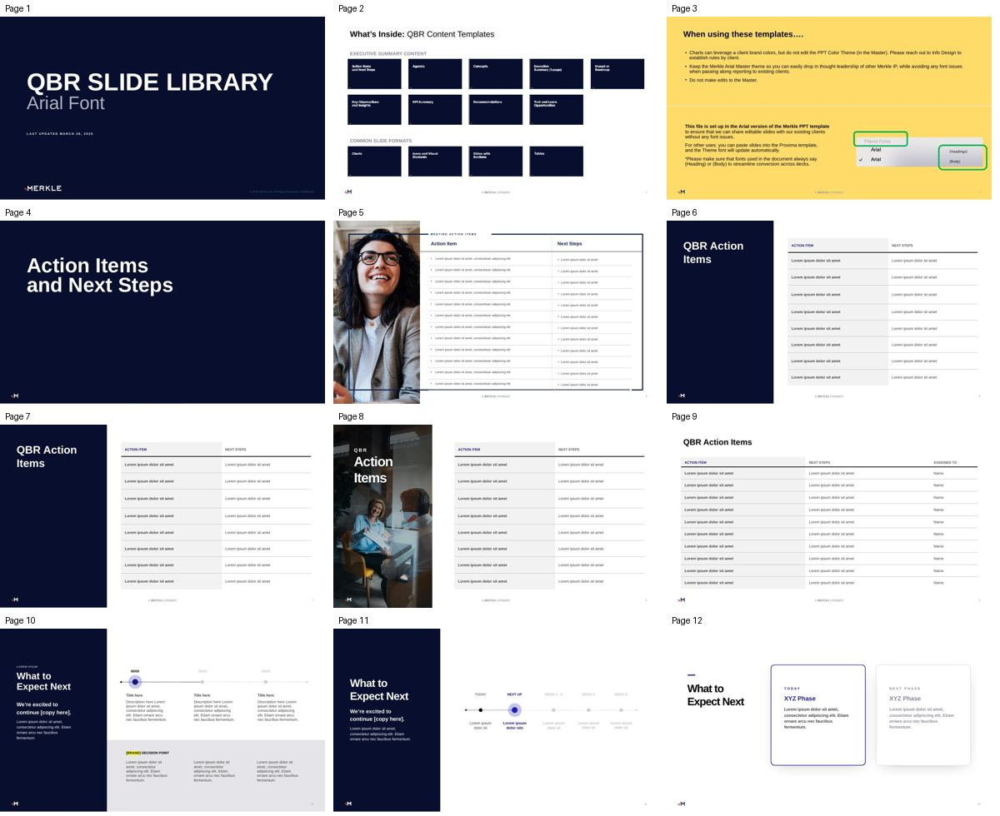](previews/qbr-001.jpg)

| ID | 页码 | 名称 | 结构和使用场景 |
|---|---:|---|---|
| QBR-001 | 1 | 资料封面 | 深蓝底标题、字体版本与更新日期；识别合集版本、参考资料封面 |
| QBR-002 | 2 | 合集目录 | 缩略卡片按内容与通用版式分类；查找整套报告结构、浏览页面类型 |
| QBR-003 | 3 | 模板使用说明 | 黄色说明区列出主题、字体和母版使用提示；了解源模板限制、跨版本制作 |
| QBR-004 | 4 | 行动与下一步章节页 | 深蓝纯色大标题；行动计划章节、会议结尾 |
| QBR-005 | 5 | 图片配双列行动表 | 左侧人物图，右侧行动项与下一步表；会议纪要、项目行动追踪 |
| QBR-006 | 6 | 深蓝侧栏行动表 | 左深蓝标题栏，右侧两列任务与下一步；项目例会、复盘行动 |
| QBR-007 | 7 | 深蓝侧栏行动表变体 | 左深蓝标题栏，右侧带浅灰底的行动表；工作安排、交付跟进 |
| QBR-008 | 8 | 图片侧栏行动表 | 左侧深色人物图与标题，右侧双列行动表；客户会后跟进、阶段待办 |
| QBR-009 | 9 | 三列行动责任表 | 全宽表格按行动项、下一步和负责人排列；会议决议、行动责任分工 |
| QBR-010 | 10 | 时间线与决策点 | 深色左栏，右侧阶段时间线与底部决策信息；项目推进、决策节点、后续规划 |
| QBR-011 | 11 | 下一步阶段时间线 | 左侧标题说明，右侧横向当前及后续阶段；项目启动、下一阶段安排 |
| QBR-012 | 12 | 当前与下一阶段双卡 | 左标题，右侧并列两张阶段卡；阶段交接、近期计划 |

## 第 13–24 页

[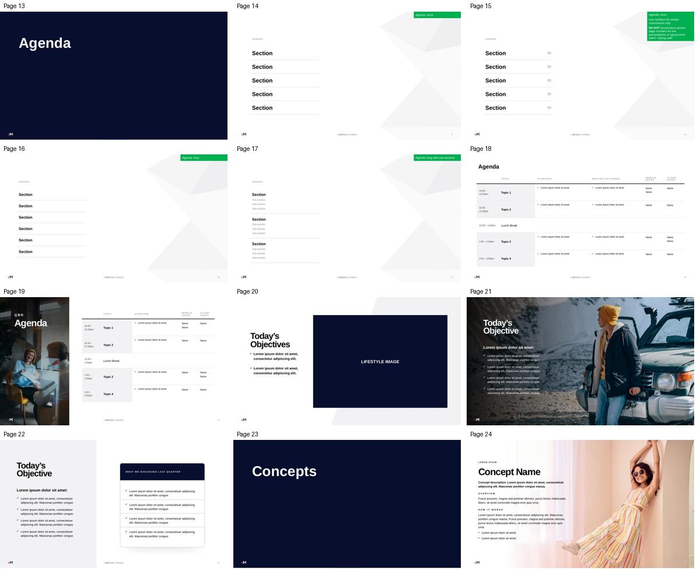](previews/qbr-013.jpg)

| ID | 页码 | 名称 | 结构和使用场景 |
|---|---:|---|---|
| QBR-013 | 13 | 议程章节页 | 深蓝底大标题；会议议程分节 |
| QBR-014 | 14 | 简短议程 | 左侧少量议题及分隔线，右侧品牌图案；短会议、项目汇报 |
| QBR-015 | 15 | 带页码简短议程 | 简短议程右侧配页码占位；书面报告目录 |
| QBR-016 | 16 | 长议程 | 较多议题按行排列，右侧图案；长会议、工作坊议程 |
| QBR-017 | 17 | 带子议题议程 | 左侧主议题与缩进子项，右侧图案；多主题会议、工作坊 |
| QBR-018 | 18 | 会议时间议程表 | 时间、主题、讨论内容与人员构成表；工作坊、项目会议排程 |
| QBR-019 | 19 | 图片侧栏时间议程 | 左侧深色图片标题，右侧时间议程表；客户会议、大型工作坊 |
| QBR-020 | 20 | 目标与视觉并列 | 左侧目标列表，右侧大图像区；项目启动目标、会议目的 |
| QBR-021 | 21 | 背景图上的会议目标 | 全幅照片上叠深色渐变、标题和目标；主题引入、简短目标页 |
| QBR-022 | 22 | 会议目标与上次回顾 | 左侧本次目标，右侧上次讨论摘要卡；阶段复盘、连续会议 |
| QBR-023 | 23 | 概念章节页 | 深蓝纯色概念章节标题；方案概念分节 |
| QBR-024 | 24 | 概念文字配大图 | 左侧概念、概览及工作方式，右侧视觉图；方案概览、产品概念 |

## 第 25–36 页

[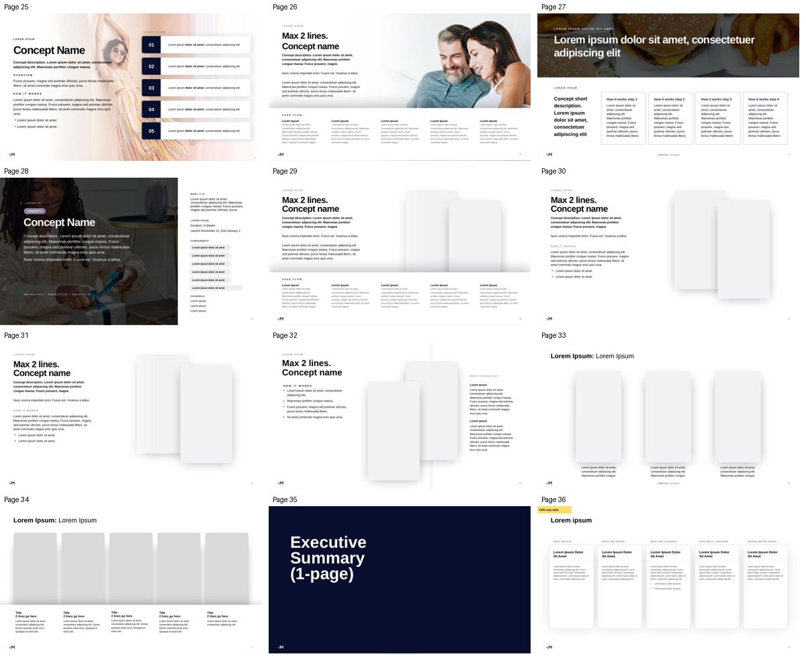](previews/qbr-025.jpg)

| ID | 页码 | 名称 | 结构和使用场景 |
|---|---:|---|---|
| QBR-025 | 25 | 概念说明与五步流程 | 左概念说明，中右图片叠五个编号步骤；用户流程、方案介绍 |
| QBR-026 | 26 | 概念与横向用户流程 | 上方概念和图片，下方五列用户流程；用户旅程、服务流程 |
| QBR-027 | 27 | 概念横幅与步骤卡 | 顶部横幅图片，下方说明及四步卡片；解决方案机制、实施步骤 |
| QBR-028 | 28 | 概念简报与侧栏信息 | 左侧深色背景概念说明，右侧组件、渠道和时间等信息；活动概念、方案提案 |
| QBR-029 | 29 | 概念截图与底部流程 | 左上概念描述，右侧截图叠层，下方分步文字；产品概念、体验流程 |
| QBR-030 | 30 | 概念截图与工作原理 | 左侧概念与工作方式，右侧叠层图片；产品方案、功能介绍 |
| QBR-031 | 31 | 概念截图与要点列表 | 左侧概述和列表，右侧叠层图像；功能方案、服务说明 |
| QBR-032 | 32 | 概念、截图与亮点 | 左侧工作方式，中央叠层图片，右侧亮点；产品演示、功能差异 |
| QBR-033 | 33 | 三张产品图及说明 | 三张竖向截图并列，下方各配简述；多页面展示、功能示意 |
| QBR-034 | 34 | 五屏截图及说明 | 五张竖向截图和标题说明横向排列；移动端体验、多功能展示 |
| QBR-035 | 35 | 执行摘要章节页 | 深蓝底单页执行摘要标题；摘要章节 |
| QBR-036 | 36 | 五栏执行回顾 | 并排五个卡片分别承载回顾、学习与下一步等内容；阶段总结、项目复盘 |

## 第 37–48 页

[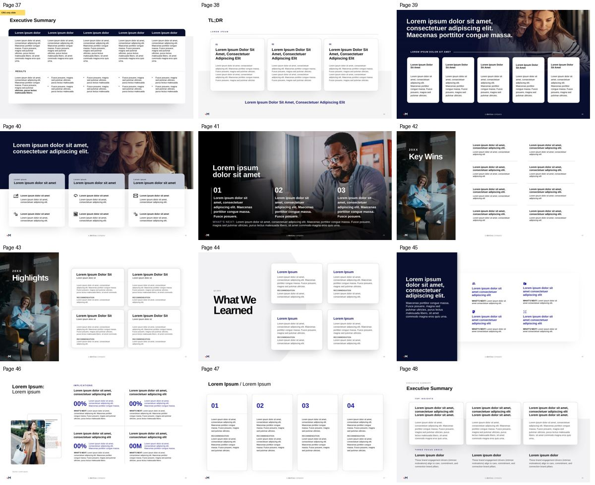](previews/qbr-037.jpg)

| ID | 页码 | 名称 | 结构和使用场景 |
|---|---:|---|---|
| QBR-037 | 37 | 多栏执行摘要与结果 | 顶部多列摘要，下部对应结果；经营复盘、项目成果汇总 |
| QBR-038 | 38 | 三项结论速览 | 三张编号卡与底部总结句；管理层摘要、结论先行 |
| QBR-039 | 39 | 深色背景五点摘要 | 顶部深色照片标题，下方五张白色竖卡；重点洞察、多项成果摘要 |
| QBR-040 | 40 | 深色横幅三栏摘要 | 顶部图片横幅，下方三列图标与说明；能力总结、关键成果 |
| QBR-041 | 41 | 全图三点总结 | 深色照片背景叠三项编号与底部下一步；高层回顾、阶段重点 |
| QBR-042 | 42 | 图片侧栏多项成果 | 左侧图片标题，右侧两列多条简要成果；项目亮点、年度或阶段成果 |
| QBR-043 | 43 | 图片侧栏四项亮点 | 左图片标题，右侧四张亮点卡；重要发现、工作成果 |
| QBR-044 | 44 | 四卡经验总结 | 左侧标题，右侧四张学习与建议卡；项目经验、阶段复盘 |
| QBR-045 | 45 | 左侧摘要与四项后续 | 深蓝左栏概述，右侧四条带图标的下一步；建议概览、决策准备 |
| QBR-046 | 46 | 图像与四项数据洞察 | 左侧标题和图片，右侧四组数字、含义及下一步；数据复盘、绩效与行动 |
| QBR-047 | 47 | 四项编号建议 | 四张竖卡配编号、说明和推荐；重点建议、四个工作方向 |
| QBR-048 | 48 | 三项洞察与关注领域 | 上方三张洞察卡，下方三个关注领域；管理摘要、战略重点 |

## 第 49–60 页

[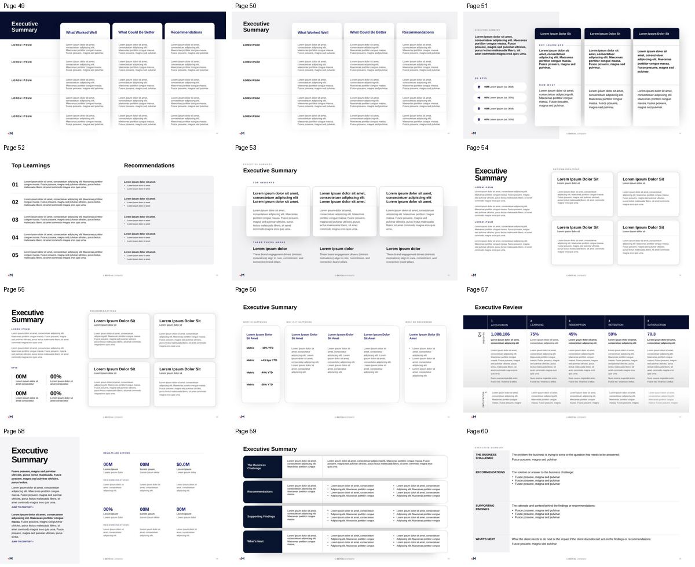](previews/qbr-049.jpg)

| ID | 页码 | 名称 | 结构和使用场景 |
|---|---:|---|---|
| QBR-049 | 49 | 深蓝顶栏回顾矩阵 | 横向主题行对应做得好、待改进及建议三列；项目复盘、工作评估 |
| QBR-050 | 50 | 浅色顶栏回顾矩阵 | 与第49页相同三列关系，改为浅色背景；团队复盘、项目评估 |
| QBR-051 | 51 | KPI 侧栏与三列洞察 | 左侧概述和 KPI，右侧三列发现与下一步；绩效摘要、管理层简报 |
| QBR-052 | 52 | 学习与建议并列 | 左侧编号学习，右侧分组建议卡；项目复盘、访谈分析 |
| QBR-053 | 53 | 三洞察与三个关注领域 | 三张洞察卡下配三个对应关注区；阶段复盘、经营摘要 |
| QBR-054 | 54 | 摘要配四项建议 | 左侧概述文字，右侧四张建议卡；业务建议、管理简报 |
| QBR-055 | 55 | 摘要与指标配建议 | 左侧概述及四个数字，右侧四张建议卡；绩效回顾、改进建议 |
| QBR-056 | 56 | 发生了什么与建议 | 四列分别呈现指标、原因/建议等摘要；指标解读、经营复盘 |
| QBR-057 | 57 | 客户旅程阶段表现 | 五列阶段卡及成果指标和说明；漏斗回顾、用户生命周期 |
| QBR-058 | 58 | 文字摘要与六项成果 | 左侧执行摘要，右侧六组结果与行动；业务报告、阶段成果 |
| QBR-059 | 59 | 业务挑战到下一步矩阵 | 深色行标题配多列挑战、建议、证据与下一步；决策简报、方案总结 |
| QBR-060 | 60 | 挑战、建议与发现列表 | 四条横向分区：挑战、建议、证据和下一步；问题解决、领导汇报 |

## 第 61–72 页

[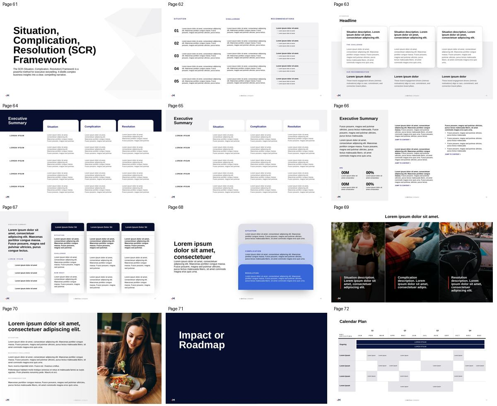](previews/qbr-061.jpg)

| ID | 页码 | 名称 | 结构和使用场景 |
|---|---:|---|---|
| QBR-061 | 61 | SCR 框架说明页 | 白底大标题说明 Situation、Complication、Resolution；结构化叙事、方案背景 |
| QBR-062 | 62 | 五条 SCR 对应矩阵 | 按行排列情境、挑战与建议三列；问题分析、整改建议 |
| QBR-063 | 63 | 三卡 SCR 结构 | 三张卡分别放情境、挑战及建议，下方关注点；问题叙述、管理简报 |
| QBR-064 | 64 | 深蓝顶栏 SCR 表 | 左侧主题，右侧情境、挑战、解决三列；多主题问题分析、执行摘要 |
| QBR-065 | 65 | 浅色 SCR 表变体 | 与第64页同构，背景改为浅色；多主题复盘、商业问题梳理 |
| QBR-066 | 66 | 摘要与指标及多列说明 | 左摘要和 KPI，右多栏论点与上下文链接；管理总结、带证据的报告 |
| QBR-067 | 67 | 摘要与三列 SCR 卡 | 左侧概要及条目，右侧三张情境、挑战与行动卡；战略问题、阶段决策 |
| QBR-068 | 68 | 左叙事与三层 SCR 卡 | 左侧标题说明，右侧三张上下叠放彩色卡；单一问题分析、方案决策 |
| QBR-069 | 69 | 三幅图片 SCR | 三列背景图分别对应情境、挑战和解决；故事化案例、概念阐释 |
| QBR-070 | 70 | 文字叙事配大图 | 左侧标题及情境、挑战、建议，右侧图片；案例讲述、商业问题与行动 |
| QBR-071 | 71 | 影响与路线图章节页 | 深蓝底大标题；路线图章节 |
| QBR-072 | 72 | 年度活动日历 | 横向月份和季度，纵向活动带和持续事项；年度计划、项目路线图 |

## 第 73–84 页

[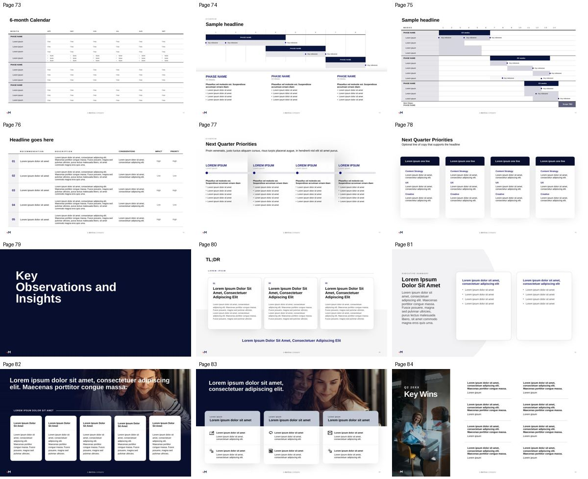](previews/qbr-073.jpg)

| ID | 页码 | 名称 | 结构和使用场景 |
|---|---:|---|---|
| QBR-073 | 73 | 六个月工作日历表 | 横向月份，纵向阶段和任务清单；半年计划、项目活动安排 |
| QBR-074 | 74 | 阶段时间条与描述 | 上方三段时间线，下方对应阶段说明；项目实施、里程碑 |
| QBR-075 | 75 | 多阶段甘特路线图 | 上方时间轴，纵向多阶段任务及时间条；项目排期、实施路线 |
| QBR-076 | 76 | 建议优先级表 | 编号建议、描述、考虑因素、影响和优先级；计划排序、管理决策 |
| QBR-077 | 77 | 四项重点与进度线 | 四列重点、上方进度标记和下方列表；下一阶段重点、工作流汇报 |
| QBR-078 | 78 | 四列重点卡片 | 四张深蓝表头卡片，内含不同工作流；计划重点、能力工作项 |
| QBR-079 | 79 | 观察与洞察章节页 | 深蓝章节标题；发现章节 |
| QBR-080 | 80 | 三项观察速览 | 三张编号卡片与总结句；核心发现、项目简报 |
| QBR-081 | 81 | 摘要与双卡发现 | 左侧概述，右侧两张带条目的卡片；两项重点、比较两类洞察 |
| QBR-082 | 82 | 图片背景五卡洞察 | 深色横幅和五张白卡；多维发现、业务回顾 |
| QBR-083 | 83 | 图片背景三栏要点 | 顶部深色图片，下方三列带图标要点；关键观察、能力回顾 |
| QBR-084 | 84 | 图片侧栏观察列表 | 左图标题、右侧两列观察条目；阶段亮点、发现汇总 |

## 第 85–96 页

[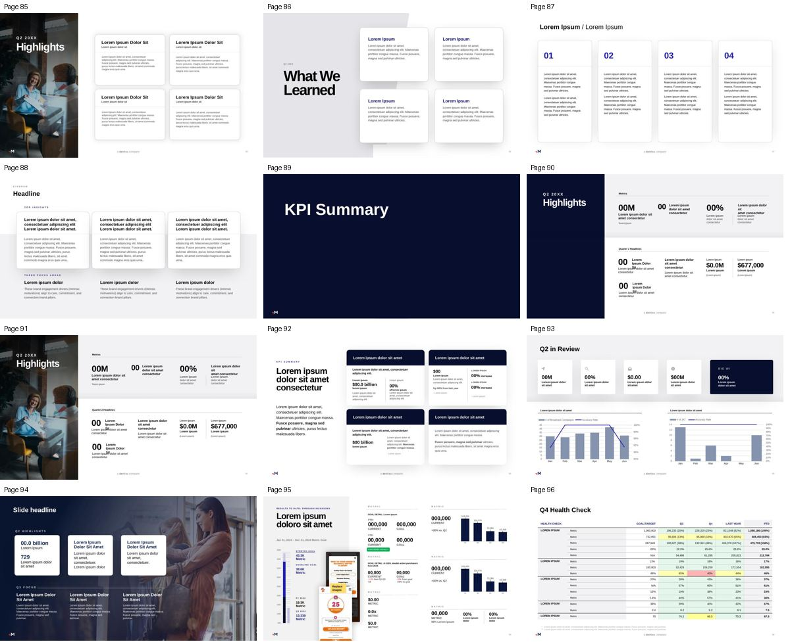](previews/qbr-085.jpg)

| ID | 页码 | 名称 | 结构和使用场景 |
|---|---:|---|---|
| QBR-085 | 85 | 图片侧栏四卡洞察 | 左图标题，右侧四张发现卡；项目亮点、工作总结 |
| QBR-086 | 86 | 四项经验卡片 | 左标题右侧四张经验卡；阶段复盘、研究学习 |
| QBR-087 | 87 | 编号四卡发现 | 四张纵向编号卡；四项洞察、问题清单 |
| QBR-088 | 88 | 三项洞察与关注领域 | 三卡与下方三项关注点；洞察总结、工作重点 |
| QBR-089 | 89 | KPI 摘要章节页 | 深蓝底大标题；指标章节 |
| QBR-090 | 90 | 深蓝侧栏 KPI 概览 | 左深色标题栏，右侧上方指标和下方亮点；经营指标、阶段成果 |
| QBR-091 | 91 | 图片侧栏 KPI 概览 | 左图片标题，右侧数字概览和亮点；业务报告、项目汇报 |
| QBR-092 | 92 | 指标与四个主题卡 | 左侧引导文字，右侧四张带数据卡片；KPI 摘要、业务指标分组 |
| QBR-093 | 93 | KPI 卡片与两张趋势图 | 上方五个数字卡，下方两张并列图表；经营回顾、营销效果报告 |
| QBR-094 | 94 | 深色图片成果与重点 | 背景图上分两行呈现亮点与后续重点；阶段成果、管理层演示 |
| QBR-095 | 95 | 活动成果及多组图表 | 左侧活动截图，右侧多个指标与柱状图；活动复盘、运营表现分析 |
| QBR-096 | 96 | 健康度指标对照表 | 行是不同指标，列为目标、周期和历史数据；业务健康度、绩效监测 |

## 第 97–108 页

[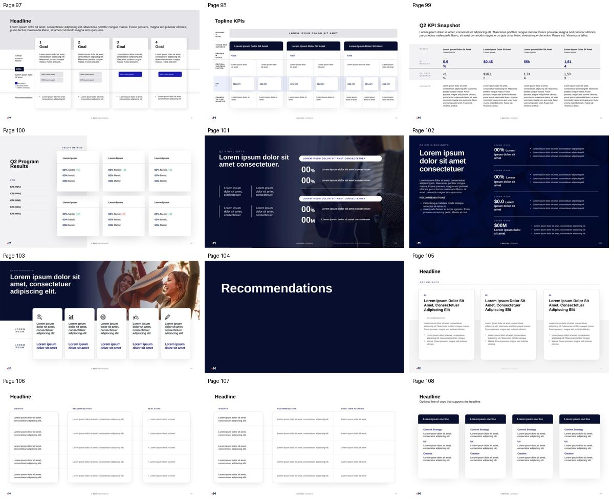](previews/qbr-097.jpg)

| ID | 页码 | 名称 | 结构和使用场景 |
|---|---:|---|---|
| QBR-097 | 97 | 目标与 KPI 四列矩阵 | 四个目标纵列，行对应指标与责任等；目标管理、绩效规划 |
| QBR-098 | 98 | 目标、指标与成果矩阵 | 横向目标维度，纵向 KPI、成果及活动；业务目标拆解、绩效跟踪 |
| QBR-099 | 99 | 多指标对比快照 | 四列指标，对比近期与此前表现并附洞察；多指标阶段回顾、经营简报 |
| QBR-100 | 100 | 左栏指标加六卡 | 左侧 KPI 说明，右侧六张健康度卡片；项目状态、运营指标 |
| QBR-101 | 101 | 深色背景双组数字 | 左侧摘要文字，右侧两个数据分组；核心指标、运营成果 |
| QBR-102 | 102 | 深色 KPI 与行动 | 左侧标题和建议，右侧多组指标与说明；绩效汇报、数据驱动建议 |
| QBR-103 | 103 | 背景图五卡表现概览 | 上方图片标题，底部五卡展示不同维度；渠道表现、业务维度比较 |
| QBR-104 | 104 | 建议章节页 | 深蓝纯色标题；建议章节 |
| QBR-105 | 105 | 三项洞察与建议 | 三张并列卡，每张包含洞察及建议；策略建议、复盘结论 |
| QBR-106 | 106 | 洞察—建议—下一步矩阵 | 三列分行呈现洞察、建议和具体下一步；决策追踪、研究转化 |
| QBR-107 | 107 | 洞察—建议—长期规划矩阵 | 三列为洞察、建议与长期计划；中长期规划、路线建议 |
| QBR-108 | 108 | 四列建议卡 | 四张深色表头卡，内部按工作类型展开；多项工作建议、策略方向 |

## 第 109–120 页

[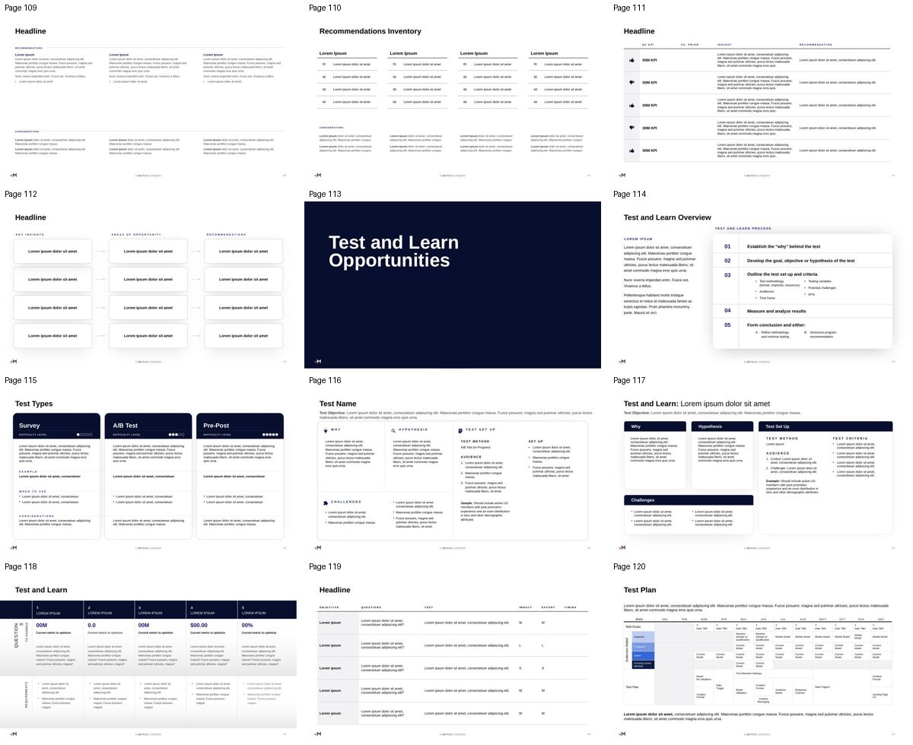](previews/qbr-109.jpg)

| ID | 页码 | 名称 | 结构和使用场景 |
|---|---:|---|---|
| QBR-109 | 109 | 多列建议与考虑因素 | 上方建议列表，下方考虑因素分列；方案比较、执行风险分析 |
| QBR-110 | 110 | 建议清单及考虑因素 | 上方多列编号建议，下方相应考虑事项；建议盘点、行动清单 |
| QBR-111 | 111 | 指标、发现与建议表 | 逐行对应 KPI、变化、洞察和建议；数据复盘、运营改进 |
| QBR-112 | 112 | 洞察—机会—建议流程 | 三列卡片以箭头逐行连接；发现到行动、机会识别 |
| QBR-113 | 113 | 测试与学习章节页 | 深蓝章节标题；实验或学习计划 |
| QBR-114 | 114 | 测试与学习过程 | 左侧说明，右侧五步测试流程及结论分支；实验流程、试点规划 |
| QBR-115 | 115 | 测试方法比较 | 三列对比调查、A/B、前后测的用途及考虑；研究方法选择、实验方法比较 |
| QBR-116 | 116 | 测试目标及设计卡 | 分区呈现原因、假设、设置和挑战；试点设计、实验立项 |
| QBR-117 | 117 | 测试设计多栏表 | 目标下分原因、假设、设置及挑战；A/B 测试方案、项目试点 |
| QBR-118 | 118 | 五项测试问题矩阵 | 五列分别列待回答问题和要求等信息；学习议程、实验机会汇总 |
| QBR-119 | 119 | 实验优先级表 | 按行列出目标、问题、测试、影响、工作量与时间；实验排序、研究计划 |
| QBR-120 | 120 | 年度测试计划示例 | 按月份展开不同测试项目和说明；项目测试排期、学习计划 |

## 第 121–132 页

[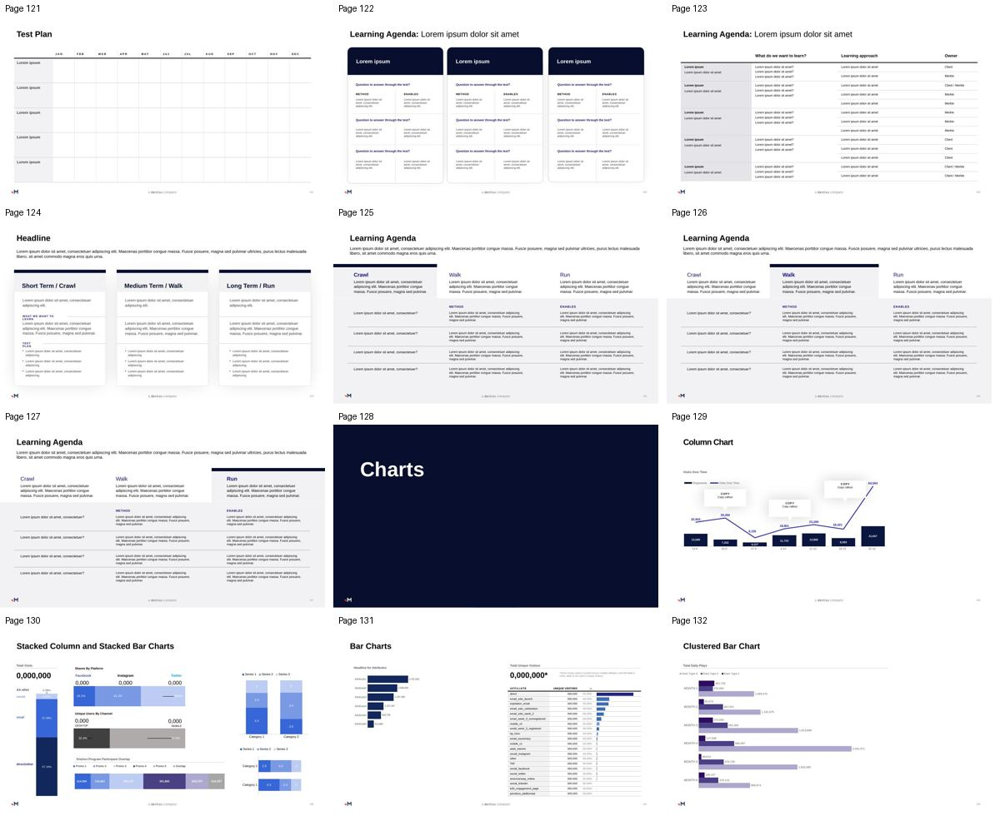](previews/qbr-121.jpg)

| ID | 页码 | 名称 | 结构和使用场景 |
|---|---:|---|---|
| QBR-121 | 121 | 空白年度测试计划 | 月份为列、项目为行的空白表；试点排期、年度实验计划 |
| QBR-122 | 122 | 三列学习议程卡 | 三列主题卡，各自列问题、方法与启用条件；研究议程、知识缺口分析 |
| QBR-123 | 123 | 学习议程表 | 逐行列学习问题、方法与负责人；调研计划、跨团队学习 |
| QBR-124 | 124 | 短中长期学习计划 | 三列阶段按时间、学习目标和测试计划组织；能力建设、分阶段验证 |
| QBR-125 | 125 | 学习议程：起步重点 | 三阶段表格，起步列上方深色强调；分阶段研究、当前阶段汇报 |
| QBR-126 | 126 | 学习议程：发展重点 | 同一三阶段结构，第二列加深色强调；阶段进度、能力发展 |
| QBR-127 | 127 | 学习议程：成熟重点 | 同一三阶段结构，第三列加深色强调；阶段路线、能力发展 |
| QBR-128 | 128 | 图表章节页 | 深蓝底标题；数据可视化章节 |
| QBR-129 | 129 | 柱线组合趋势图 | 深蓝柱与折线展示时间序列并配标注；趋势分析、流量与表现 |
| QBR-130 | 130 | 堆叠柱与条形图组合 | 多种堆叠比例图及平台和渠道示例；渠道构成、分布对比 |
| QBR-131 | 131 | 横向条形与表格 | 左侧排序横条，右侧数字表及短横条；属性排名、受众比较 |
| QBR-132 | 132 | 分组横向条形图 | 多个类别的分组横条并列比较；分群比较、多系列指标 |

## 第 133–144 页

[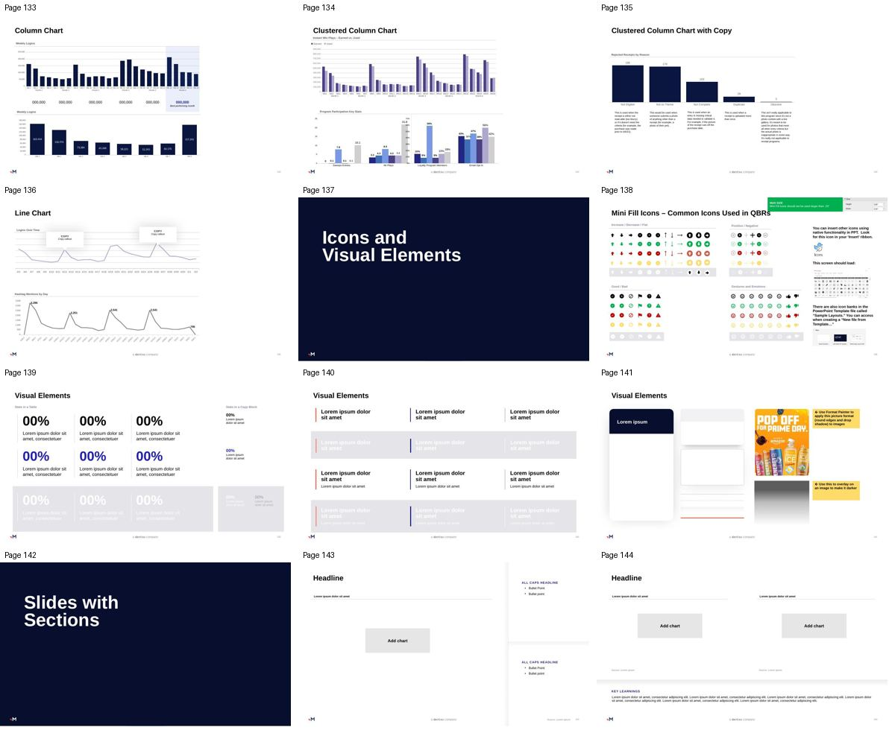](previews/qbr-133.jpg)

| ID | 页码 | 名称 | 结构和使用场景 |
|---|---:|---|---|
| QBR-133 | 133 | 上下两组柱状图 | 上方细粒度时间序列，下方汇总柱图；周度与日度趋势、运营表现 |
| QBR-134 | 134 | 两组分组柱状图 | 上下两张多系列分组柱图；渠道或群组比较、运营表现 |
| QBR-135 | 135 | 柱图配分栏说明 | 顶部类别柱状图，下方对应文字解释；分类表现、原因说明 |
| QBR-136 | 136 | 双折线趋势图 | 上下两个时间折线图，上图带标注；趋势回顾、时间序列比较 |
| QBR-137 | 137 | 图标与视觉元素章节页 | 深蓝章节标题；视觉素材导航 |
| QBR-138 | 138 | QBR 常用图标参考 | 按方向、状态等分组的图标示例；指标状态、用户情绪、方向标记 |
| QBR-139 | 139 | 数字强调样式 | 深色、蓝色和浅底统计数字样式示例；数据卡、关键数字 |
| QBR-140 | 140 | 色条文字强调样式 | 不同色条和底色的文字样式；引用、重点提示、结论标记 |
| QBR-141 | 141 | 卡片、图片和遮罩样式 | 卡片底色、阴影、图片和渐变遮罩样例；图片处理、内容卡片 |
| QBR-142 | 142 | 分区页面章节页 | 深蓝底标题；组合图表布局导航 |
| QBR-143 | 143 | 主图表加右侧双区说明 | 左大图和文字，右侧两段分区说明；单图分析、图表与结论 |
| QBR-144 | 144 | 双图并排与底部结论 | 两张图表并排，下方关键学习；指标比较、数据分析 |

## 第 145–156 页

[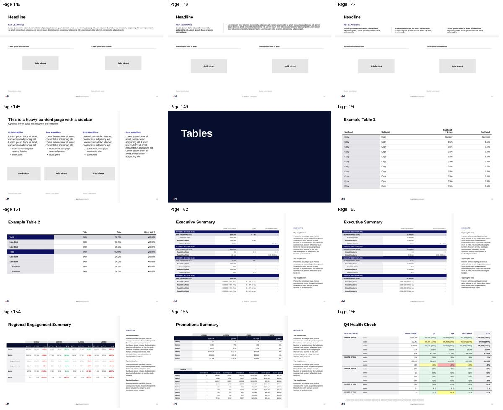](previews/qbr-145.jpg)

| ID | 页码 | 名称 | 结构和使用场景 |
|---|---:|---|---|
| QBR-145 | 145 | 顶部结论与双图 | 上方横向关键学习，下方两张图；先结论后证据、指标汇报 |
| QBR-146 | 146 | 两条学习与双图 | 上方两列关键学习，下方双图；双指标比较、成果分析 |
| QBR-147 | 147 | 三条学习与双图 | 顶部三列关键学习，下方双图；多发现摘要、数据故事 |
| QBR-148 | 148 | 三图、三段正文与侧栏 | 主体三列文字和图表，右侧独立说明栏；详细分析、书面报告 |
| QBR-149 | 149 | 表格章节页 | 深蓝底标题；表格样式导航 |
| QBR-150 | 150 | 浅灰基础表 | 左侧分类列浅灰底，右侧数值列；指标清单、业务数据表 |
| QBR-151 | 151 | 深蓝分组表 | 深蓝合计行与灰色子项交替；分组汇总、运营指标表 |
| QBR-152 | 152 | 宽表与右侧洞察 | 左侧多组绩效表，右侧文字解释；经营复盘、指标洞察 |
| QBR-153 | 153 | 宽表与洞察变体 | 多组表格和右侧独立洞察栏；绩效总结、管理报告 |
| QBR-154 | 154 | 区域表现表与洞察 | 跨区域指标表与右侧重点结论；区域对比、渠道表现 |
| QBR-155 | 155 | 双表与右侧洞察 | 两组促销数据表上下排列，右侧说明；活动表现比较、多组数据汇总 |
| QBR-156 | 156 | 健康度指标表 | 多组指标行及目标、历史周期，含颜色标记；阶段健康度、业务绩效追踪 |

