# Slide Library 页面版式

> 缩略图为源 PPT 的转换预览，示例中的客户信息和数据仅供版式参考；具体素材与事实应根据当前项目核实。图片可点击放大。

GitHub 可直接查看目录及预览，交互式离线版本请下载仓库内的 HTML 文件。

## 第 1–12 页

[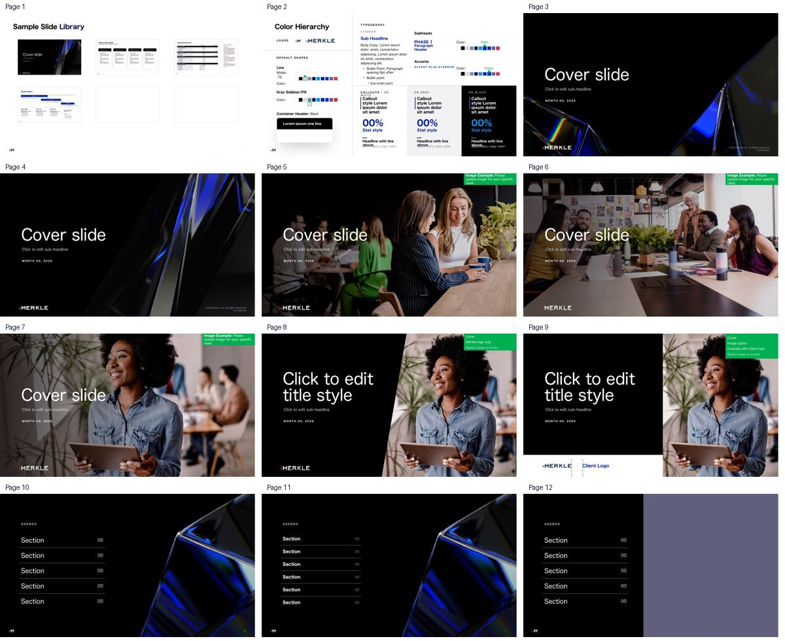](previews/slide-001.jpg)

| ID | 页码 | 名称 | 结构与适用场景 |
|---|---:|---|---|
| SL-001 | 1 | 版式库总览 | 标题与多个页面缩略示例；快速浏览版式方向 |
| SL-002 | 2 | 视觉规范示意 | 颜色、线条、形状、文字层级及浅灰黑背景上的示例；查看颜色和版式组件 |
| SL-003 | 3 | 黑底棱镜封面一 | 左侧标题、副标题、日期，右下蓝黑棱镜；方案封面、项目汇报 |
| SL-004 | 4 | 黑底棱镜封面二 | 左侧标题、副标题、日期，右侧竖向棱镜；正式方案封面、章节入口 |
| SL-005 | 5 | 会议照片全幅封面 | 满版人物照片与左侧标题、副标题、日期；客户提案、项目介绍 |
| SL-006 | 6 | 团队会议全幅封面 | 满版会议场景与左侧标题、副标题、日期；协作项目、工作坊方案 |
| SL-007 | 7 | 人物全幅封面 | 满版人物照片与左侧标题、副标题、日期；客户体验、服务主题封面 |
| SL-008 | 8 | 左黑右图封面 | 左侧黑底标题，右侧可替换人物照片；客户方案、品牌介绍 |
| SL-009 | 9 | 双品牌左黑右图封面 | 左侧标题、右侧照片，底部并列 Merkle 与客户标志；联合方案、客户提案 |
| SL-010 | 10 | 黑底棱镜短议程 | 左侧章节与页码，右侧大幅棱镜；短议程、章节导航 |
| SL-011 | 11 | 黑底棱镜长议程 | 左侧多行章节，右侧棱镜背景；多章节议程 |
| SL-012 | 12 | 黑底配右侧图片议程 | 左侧深色议程，右侧图片区域；图文议程、品牌演示 |

## 第 13–24 页

[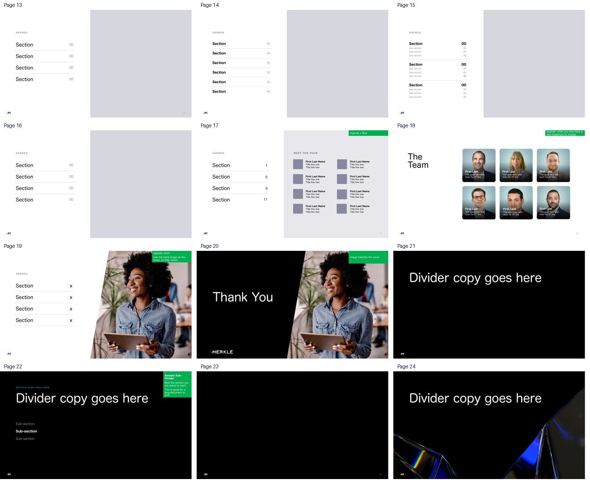](previews/slide-013.jpg)

| ID | 页码 | 名称 | 结构与适用场景 |
|---|---:|---|---|
| SL-013 | 13 | 浅色短议程一 | 左侧四项带页码，右侧浅灰图片区；短议程、会议结构 |
| SL-014 | 14 | 浅色多项议程 | 左侧多项紧凑列表，右侧浅灰图片区；较多章节、快速目录 |
| SL-015 | 15 | 带子章节议程 | 章节主项、缩进子项与页码，右侧浅灰图片区；复杂议程、长文档导航 |
| SL-016 | 16 | 浅色短议程二 | 左侧章节与页码列表，右侧浅灰图片区；短议程、会议导航 |
| SL-017 | 17 | 议程与团队简介并列 | 左侧议程，右侧多名团队成员及简介；会议议程、团队介绍 |
| SL-018 | 18 | 少量成员头像展示 | 左侧团队标题，右侧头像、姓名与职务网格；团队介绍、核心成员 |
| SL-019 | 19 | 短议程与封面同图 | 左侧短议程，右侧照片；简短议程、封面视觉延续 |
| SL-020 | 20 | 左右分栏图片结束页 | 左侧黑底，右侧图片；演示结束、封面视觉呼应 |
| SL-021 | 21 | 黑底章节分隔 | 深色背景与大标题；章节切换、主题过渡 |
| SL-022 | 22 | 带子章节导航的分隔页 | 章节名、标题及子章节列表；长文档、RFP章节切换 |
| SL-023 | 23 | 黑色留白分隔页 | 黑色背景与页脚；视觉过渡、章节留白 |
| SL-024 | 24 | 黑底棱镜分隔页 | 深色章节标题与右侧蓝黑棱镜；章节切换、方案分段 |

## 第 25–36 页

[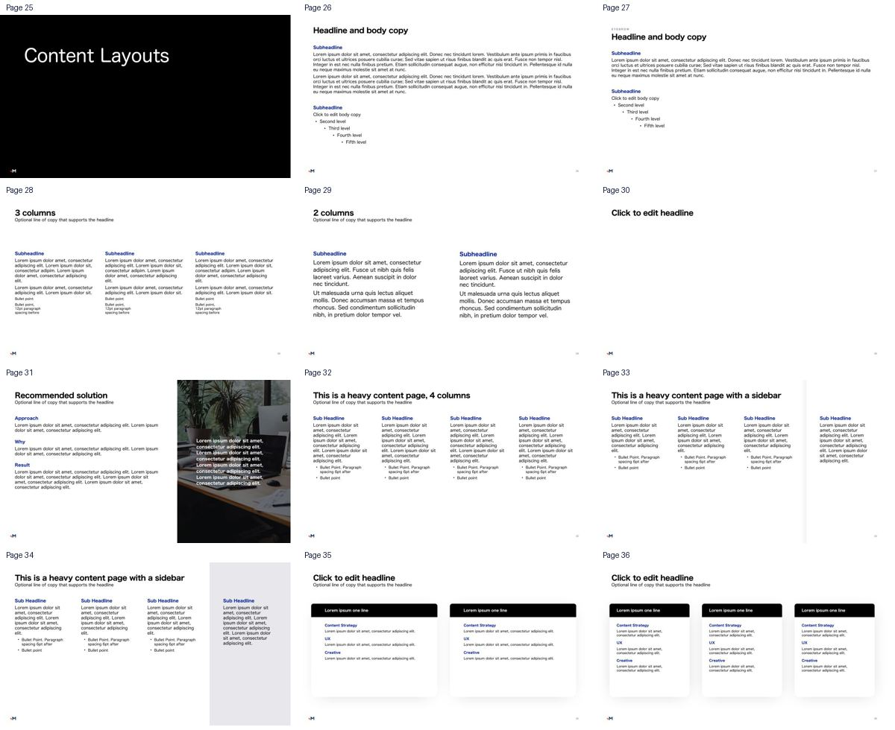](previews/slide-025.jpg)

| ID | 页码 | 名称 | 结构与适用场景 |
|---|---:|---|---|
| SL-025 | 25 | 内容版式章节页 | 深色背景与内容版式标题；内容版式章节导航 |
| SL-026 | 26 | 标题与单栏正文 | 页首标题，下方子标题、段落与多级列表；背景说明、概念解释 |
| SL-027 | 27 | 带眉题的单栏正文 | 眉题、标题与单栏段落、列表；主题背景、结构化说明 |
| SL-028 | 28 | 三栏并列文本 | 标题与辅助说明，下方三个平行栏；三项能力、三类观点、比较 |
| SL-029 | 29 | 两栏并列文本 | 标题与辅助说明，下方两栏；双方案比较、两类观点 |
| SL-030 | 30 | 仅标题内容页 | 左上标题与大面积空白正文区；自由图表、图文组合 |
| SL-031 | 31 | 推荐方案与右侧图片 | 左侧按方法、原因、结果分段，右侧带文字的图片；方案说明、建议摘要 |
| SL-032 | 32 | 四栏密集正文 | 标题、辅助行和四个等宽文字栏；多维内容、信息密集型比较 |
| SL-033 | 33 | 四栏与浅灰侧栏 | 四栏正文，右侧为浅色侧区；多主题解读、要点与辅助信息 |
| SL-034 | 34 | 四栏与灰色强调侧栏 | 四栏文本，末栏放在较深灰色侧区；多维比较、突出最后一项 |
| SL-035 | 35 | 双卡片内容对照 | 两张白色卡片，黑色卡头和分层正文；双方案、两个模块 |
| SL-036 | 36 | 三卡片并列 | 三张白卡及黑色卡头，每卡含分层正文；三项服务、三类能力 |

## 第 37–48 页

[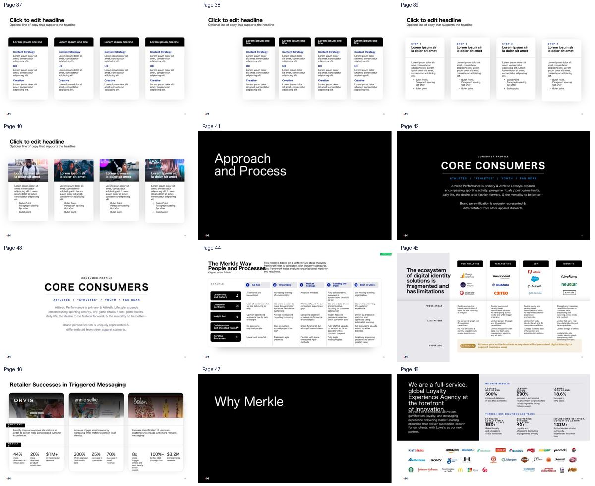](previews/slide-037.jpg)

| ID | 页码 | 名称 | 结构与适用场景 |
|---|---:|---|---|
| SL-037 | 37 | 四卡片并列 | 四张白卡及黑色卡头；四个主题、四个模块对照 |
| SL-038 | 38 | 右侧集中四卡片 | 左侧保留空白，四张窄卡从中部向右排列；左侧摘要加四项明细、紧凑模块 |
| SL-039 | 39 | 四步骤文字卡片 | 四个带步骤标签的白色卡片，附段落和项目符号；流程分步、四阶段交付 |
| SL-040 | 40 | 四图片卡片 | 四列图片卡头与文本说明；四项能力、四类方案、阶段概览 |
| SL-041 | 41 | 方法与流程章节页 | 深色背景与章节标题；方法论章节 |
| SL-042 | 42 | 黑底中心定位陈述 | 中心大标题、简短分类与说明文字；核心受众、定位陈述 |
| SL-043 | 43 | 白底中心定位陈述 | 居中大标题、分类及简短说明；核心观点、受众定位 |
| SL-044 | 44 | 五级成熟度矩阵 | 五个成熟度阶段横列，多个评估维度纵列；成熟度诊断、能力评估 |
| SL-045 | 45 | 多方案生态比较矩阵 | 左侧结论，右侧方案列与关注点、局限、价值行；平台比较、能力对照、市场生态 |
| SL-046 | 46 | 三案例结果对比 | 三张案例卡，包含图片、挑战、方案和指标；案例集锦、结果比较 |
| SL-047 | 47 | Why Merkle 章节页 | 黑底大标题；公司能力章节 |
| SL-048 | 48 | 能力宣言与证据网格 | 左侧公司定位，右侧指标，下方品牌标志；公司介绍、能力与业绩 |

## 第 49–60 页

[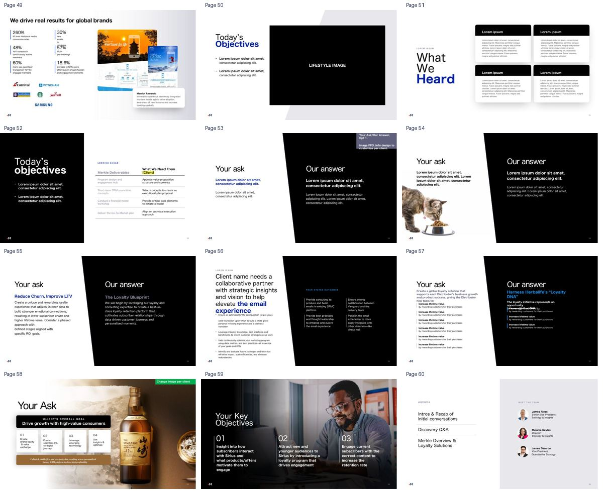](previews/slide-049.jpg)

| ID | 页码 | 名称 | 结构与适用场景 |
|---|---:|---|---|
| SL-049 | 49 | 业绩指标与交付展示 | 左侧多项指标，右侧示意图与案例摘要；成果概览、品牌业绩 |
| SL-050 | 50 | 目标列表与场景图片 | 左侧目标要点，右侧大图；会议目标、项目目标 |
| SL-051 | 51 | 听取反馈四卡片 | 左侧大标题，右侧四张文本卡；客户反馈、需求归纳 |
| SL-052 | 52 | 会议目标与双方分工 | 左侧目标列表，右侧双方交付与配合表；工作坊目标、双方责任 |
| SL-053 | 53 | 客户需求与方案回应 | 左右两块，对应客户诉求与回应；需求回应、方案开场 |
| SL-054 | 54 | 需求回应与图片 | 左右需求回应结构，左侧加入图片；问题与建议、图文对照 |
| SL-055 | 55 | 需求回应文字详版 | 白底需求与黑底回应两栏；客户诉求、方案定位 |
| SL-056 | 56 | 客户目标与预期成果 | 左侧背景与需求，右侧预期成果分栏；需求理解、成果对齐 |
| SL-057 | 57 | 需求与方案详细列表 | 左侧客户诉求，右侧方案回应与列表；方案回应、目标拆解 |
| SL-058 | 58 | 客户总目标与四项重点 | 背景图片，上层总目标、下层四项支柱；战略目标、需求框架 |
| SL-059 | 59 | 背景图与三项关键目标 | 大背景图片，标题下排列三项目标；项目目标、方向对齐 |
| SL-060 | 60 | 议程与三人团队 | 左侧议程，右侧头像及职务；会议议程、介绍参会成员 |

## 第 61–72 页

[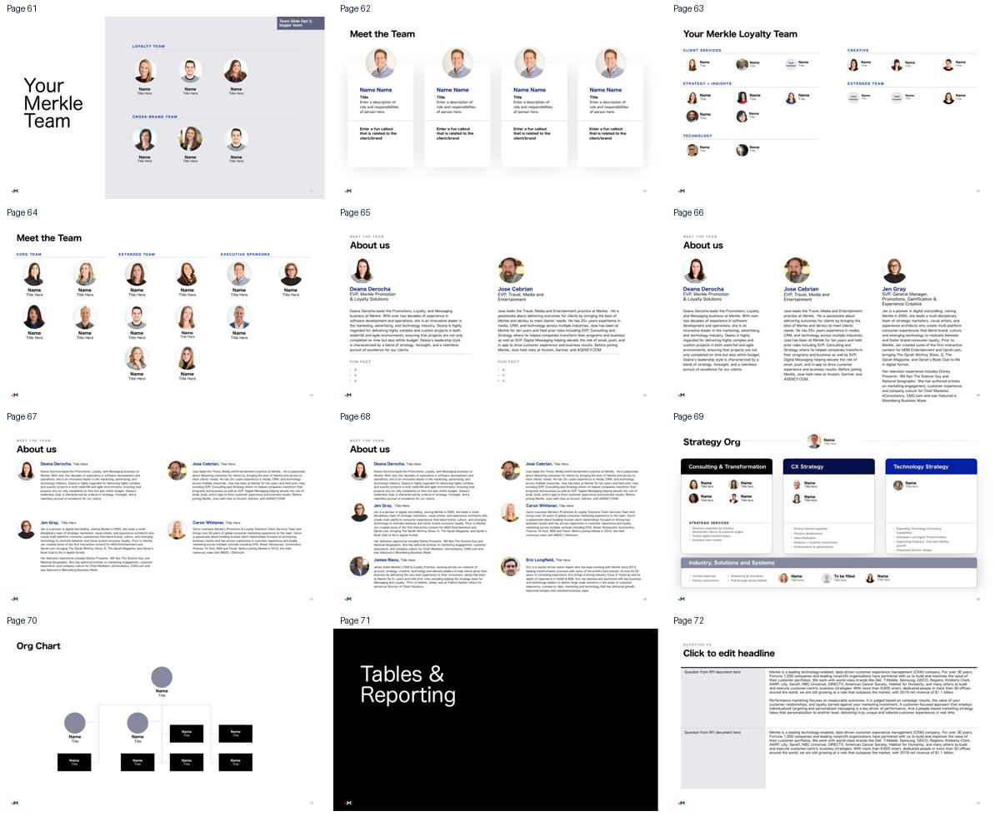](previews/slide-061.jpg)

| ID | 页码 | 名称 | 结构与适用场景 |
|---|---:|---|---|
| SL-061 | 61 | 团队分组展示 | 左侧标题，右侧两组团队头像；较大团队、跨团队协作 |
| SL-062 | 62 | 四名成员介绍卡 | 四张竖卡展示头像、姓名、职责；核心团队、人员简介 |
| SL-063 | 63 | 多职能团队清单 | 按职能分区展示多位成员与职位；跨职能团队、责任分工 |
| SL-064 | 64 | 核心团队与扩展团队 | 按核心、扩展、赞助人分组展示；治理结构、团队组成 |
| SL-065 | 65 | 双人详细简介 | 两栏头像、姓名、职位及履历；关键人物介绍、领导简介 |
| SL-066 | 66 | 三人详细简介 | 三栏人物头像与履历；管理团队、专家介绍 |
| SL-067 | 67 | 四人简介清单 | 两列多行头像与简介；团队背景、专家名册 |
| SL-068 | 68 | 六人简介清单 | 两列多行，多个头像与简介；扩展专家团队、人员简介 |
| SL-069 | 69 | 职能团队结构 | 三列业务职能卡，下方横向支持职能；职能分工、团队能力 |
| SL-070 | 70 | 层级组织图 | 上级节点与下级节点的树状关系；组织架构、汇报关系 |
| SL-071 | 71 | 表格与汇报章节页 | 黑底大标题；数据汇报章节 |
| SL-072 | 72 | 问答表格 | 标题下两行问题与回答；RFP回应、问答汇总 |

## 第 73–84 页

[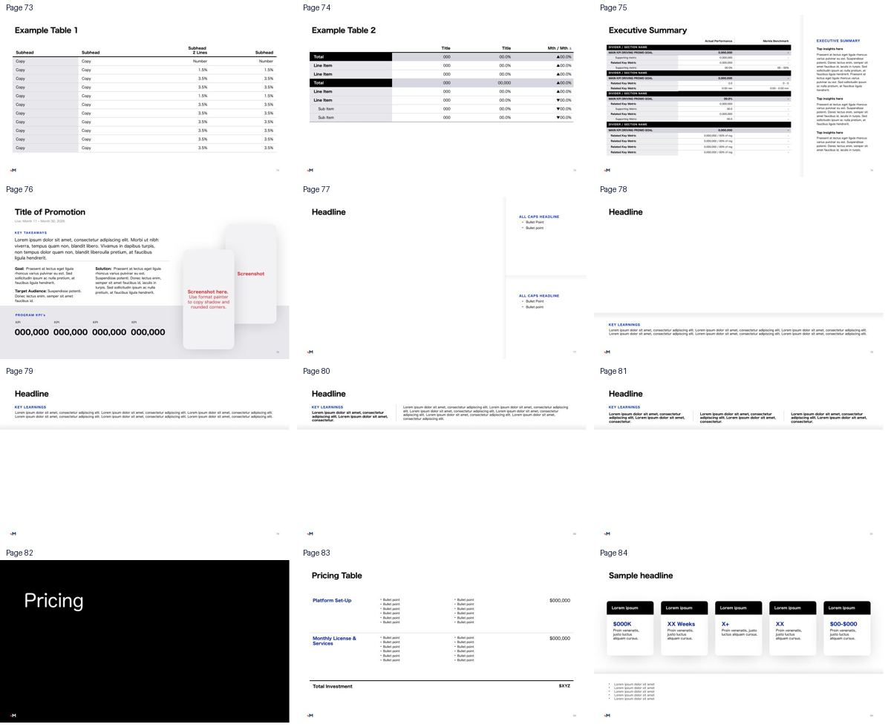](previews/slide-073.jpg)

| ID | 页码 | 名称 | 结构与适用场景 |
|---|---:|---|---|
| SL-073 | 73 | 基础数据表 | 多列标题与斑马纹行；数据明细、指标表 |
| SL-074 | 74 | 层级指标表 | 黑色汇总行、灰色明细与多列比较；业绩汇总、财务明细 |
| SL-075 | 75 | 执行摘要与指标表 | 左侧密集绩效表，右侧摘要；管理层汇报、结果与洞察 |
| SL-076 | 76 | 活动总结与截图 | 左侧目标、受众、方案及指标，右侧叠放截图；营销活动复盘、项目结果 |
| SL-077 | 77 | 右侧双摘要面板 | 大面积主体区，右侧上下两块短文字；主体内容加侧栏、补充要点 |
| SL-078 | 78 | 底部关键学习 | 上方大面积正文区，下方一条关键学习；图表加总结、分析结论 |
| SL-079 | 79 | 顶部关键学习 | 上方关键学习，下方大面积主体区；结论先行、分析图表 |
| SL-080 | 80 | 双列顶部学习与主体 | 顶部双列要点，下方主体空间；两项核心结论、对照分析 |
| SL-081 | 81 | 三列顶部学习与主体 | 顶部三列要点，下方主体空间；三项发现、三维对比 |
| SL-082 | 82 | 报价章节页 | 黑底报价标题；商务报价章节 |
| SL-083 | 83 | 分项报价清单 | 按设置费、持续服务和总额分区；分项报价、费用说明 |
| SL-084 | 84 | 五张指标和报价卡 | 五张黑色标题卡，突出金额、周期或其他数值；方案关键数字、商业摘要 |

## 第 85–96 页

[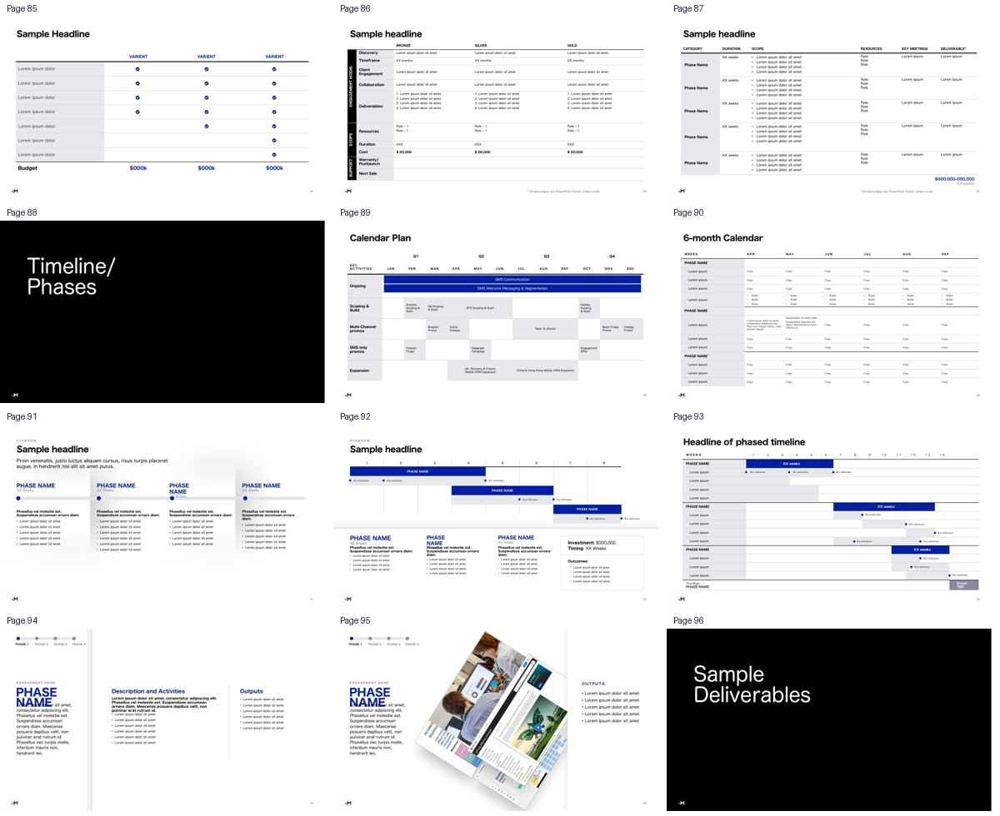](previews/slide-085.jpg)

| ID | 页码 | 名称 | 结构与适用场景 |
|---|---:|---|---|
| SL-085 | 85 | 三方案勾选对照 | 功能行、三列方案及预算行；报价档位、功能范围对比 |
| SL-086 | 86 | 三档服务范围比较表 | 三种档位与发现、参与、交付、周期等行；服务套餐、合作模式对照 |
| SL-087 | 87 | 按阶段范围与报价表 | 阶段、周期、范围、资源、会议、交付列；项目范围、工作说明、报价 |
| SL-088 | 88 | 时间轴与阶段章节页 | 黑底章节标题；项目计划章节 |
| SL-089 | 89 | 年度活动日历 | 月份横轴、活动分行与跨期色条；年度计划、渠道活动排期 |
| SL-090 | 90 | 六个月阶段日历表 | 月份横轴、阶段分行与每月任务；半年路线图、阶段计划 |
| SL-091 | 91 | 四阶段文字说明 | 四个阶段横向排列，附周期和任务；阶段方法、工作安排 |
| SL-092 | 92 | 时间轴与阶段摘要 | 上方跨期甘特与里程碑，下方阶段说明和商业信息框；项目计划、交付阶段 |
| SL-093 | 93 | 详细甘特计划 | 按周横轴、阶段任务行、条形与里程碑；项目排期、阶段依赖 |
| SL-094 | 94 | 阶段说明与产出 | 左侧当前阶段及导航，右侧活动与产出；单阶段工作说明、活动与交付 |
| SL-095 | 95 | 阶段说明与交付视觉 | 左侧阶段摘要，中间示意图，右侧产出；阶段成果、交付说明 |
| SL-096 | 96 | 示例交付物章节页 | 深色背景与章节标题；交付物章节 |

## 第 97–108 页

[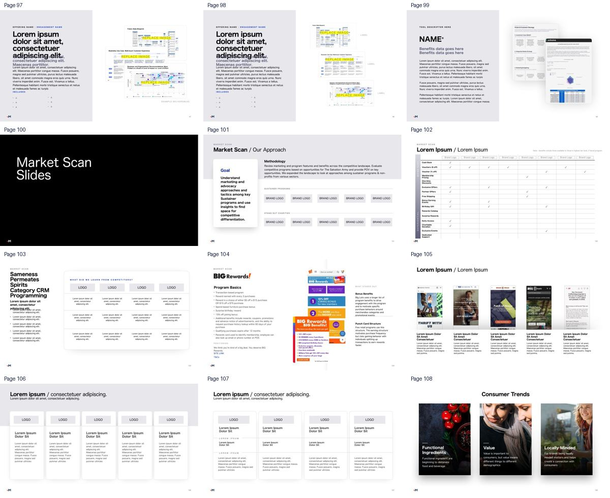](previews/slide-097.jpg)

| ID | 页码 | 名称 | 结构与适用场景 |
|---|---:|---|---|
| SL-097 | 97 | 文字加叠放交付物截图 | 左侧方案与包含内容，右侧叠放截图；交付物预览、服务介绍 |
| SL-098 | 98 | 带标签的交付物截图 | 左侧说明与包含内容，右侧三张截图及标签；多项交付、成果预览 |
| SL-099 | 99 | 工具说明与截图 | 左侧工具名称、价值和说明，右侧截图叠放；工具介绍、能力演示 |
| SL-100 | 100 | 市场扫描章节页 | 黑底章节标题；竞品与市场章节 |
| SL-101 | 101 | 市场扫描方法与品牌范围 | 目标、方法及分组品牌标志；竞品研究、市场扫描方法 |
| SL-102 | 102 | 竞品权益矩阵 | 品牌横列，权益项目纵列与勾选；竞品功能对比、权益扫描 |
| SL-103 | 103 | 竞品洞察与对比卡 | 左侧主要发现，右侧多品牌对比表；竞品结论、市场机会 |
| SL-104 | 104 | 单一竞品项目拆解 | 项目规则、视觉截图和突出特点；竞品案例、会员项目研究 |
| SL-105 | 105 | 多页面示例与说明 | 多张网站或界面截图横排，各附文字；竞品页面比较、内容审核 |
| SL-106 | 106 | 五品牌并列卡 | 五个品牌标志及说明卡；五方竞品比较、供应商比较 |
| SL-107 | 107 | 四品牌多维对比卡 | 四列品牌，各列分多个说明模块；竞品能力、权益比较 |
| SL-108 | 108 | 三趋势图片卡 | 三张图片叠加趋势标题与简述；趋势概览、三个洞察 |

## 第 109–120 页

[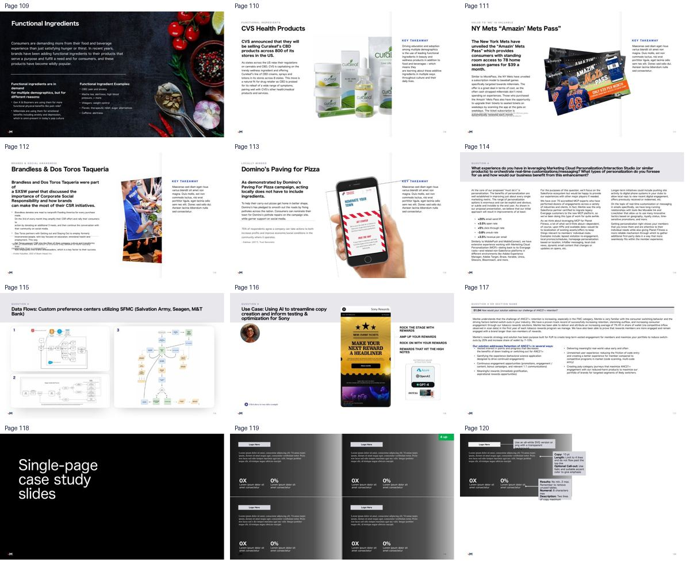](previews/slide-109.jpg)

| ID | 页码 | 名称 | 结构与适用场景 |
|---|---:|---|---|
| SL-109 | 109 | 深色趋势详解 | 大背景图，上方主题说明，下方分两组内容；趋势解释、人群需求 |
| SL-110 | 110 | 趋势案例与结论一 | 左侧案例说明，中间产品图，右侧关键结论；市场趋势案例、案例解读 |
| SL-111 | 111 | 趋势案例与结论二 | 左侧案例说明，中间图片，右侧关键结论；产品案例、会员案例 |
| SL-112 | 112 | 趋势案例与结论三 | 左侧案例和引述，中间照片，右侧结论；品牌案例、社会趋势 |
| SL-113 | 113 | 趋势案例与结论四 | 左侧案例正文，中间手机截图，右侧结论；营销案例、本地化实践 |
| SL-114 | 114 | 长问题与三栏回答 | 上方问题带，下方三栏说明；RFP回应、技术方案解答 |
| SL-115 | 115 | 三张数据流截图 | 上方问题带，下方三张编号示意图；数据流说明、多案例架构 |
| SL-116 | 116 | 用例说明与移动端示例 | 左侧人物和文字，中间手机示例，右侧工具与文案；AI用例、内容生成演示 |
| SL-117 | 117 | 问题背景与双栏回应 | 上方问题带，背景说明，下方两栏要点；RFP答复、挑战与回应 |
| SL-118 | 118 | 单页案例章节页 | 黑底大标题；案例研究章节 |
| SL-119 | 119 | 四案例并列 | 黑底四块案例摘要，每块含标志与两个指标；多案例概览、客户案例合集 |
| SL-120 | 120 | 单案例摘要组件 | 标志、短文及最多两个指标，带灰色说明文字；案例摘要、复用案例模块 |

## 第 121–132 页

[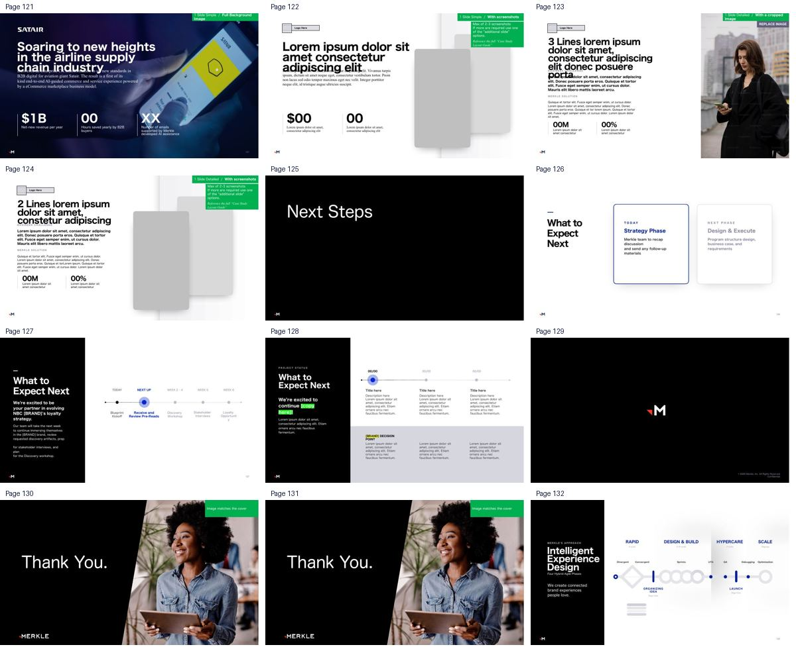](previews/slide-121.jpg)

| ID | 页码 | 名称 | 结构与适用场景 |
|---|---:|---|---|
| SL-121 | 121 | 全背景单页案例 | 满版图片与左侧标题、摘要和指标；单页案例、视觉主导案例 |
| SL-122 | 122 | 带截图的精简单页案例 | 左侧标题、摘要、指标，右侧截图；单页案例、产品成果展示 |
| SL-123 | 123 | 带裁切图片的详细案例 | 左侧挑战、方案与结果，右侧竖幅图片；详细案例、挑战与解决方案 |
| SL-124 | 124 | 带截图的详细案例 | 左侧挑战、方案与结果，右侧叠放截图；详细案例、解决方案成果 |
| SL-125 | 125 | 下一步章节页 | 黑底标题；后续工作章节 |
| SL-126 | 126 | 当前与下一阶段 | 左侧标题，右侧并列今天和下一阶段卡片；会议收尾、下一阶段安排 |
| SL-127 | 127 | 下一步横向节点 | 左侧背景说明，右侧按时间排列节点；下一步计划、项目启动 |
| SL-128 | 128 | 项目进度与决策点 | 左侧项目状态，右侧时间节点和决策区；项目状态、决策节点 |
| SL-129 | 129 | 黑底中央 M 结束页 | 黑色背景、中央 M 及底部版权；正式结束页 |
| SL-130 | 130 | 左右分栏图片结束页一 | 左侧黑底，右侧照片；结束页、封面呼应 |
| SL-131 | 131 | 左右分栏图片结束页二 | 左侧黑底，右侧照片；结束页、封面呼应 |
| SL-132 | 132 | 四阶段体验设计流程 | 左侧简介，右侧从发散收敛到冲刺、发布和规模化；设计交付方法、阶段流程 |

## 第 133–139 页

[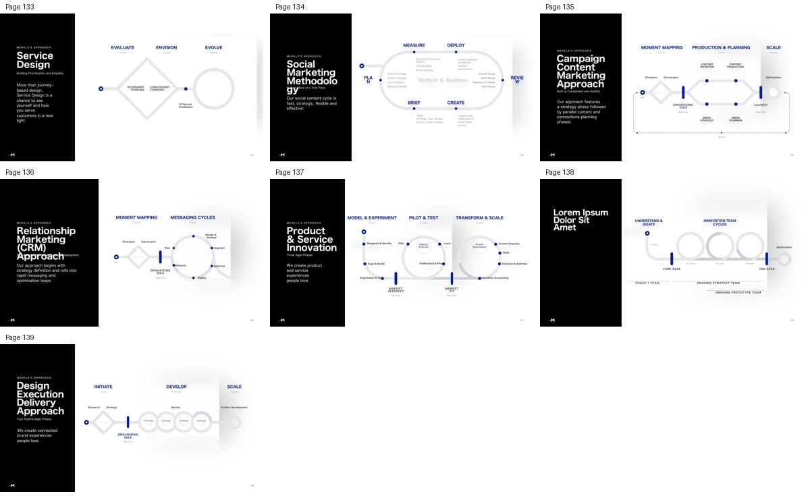](previews/slide-133.jpg)

| ID | 页码 | 名称 | 结构与适用场景 |
|---|---:|---|---|
| SL-133 | 133 | 评估、构想、演进 | 左侧服务设计说明，右侧发散收敛与持续演进；服务设计、探索与收敛 |
| SL-134 | 134 | 社交内容循环 | 左侧方法说明，右侧简报、创建、审核、发布与衡量循环；内容运营、持续优化 |
| SL-135 | 135 | 内容与媒介并行规划 | 左侧方法说明，右侧策略后内容、媒介并行阶段；营销活动、跨团队规划 |
| SL-136 | 136 | CRM 消息迭代循环 | 左侧方法说明，右侧策略与消息计划、部署、衡量循环；CRM、消息运营、测试优化 |
| SL-137 | 137 | 三阶段产品服务创新 | 左侧简介，右侧试验、试点、规模化和循环节点；产品创新、服务创新、试点 |
| SL-138 | 138 | 创新团队多周期排期 | 左侧标题，右侧阶段、连续周期和团队泳道；创新计划、并行团队排期 |
| SL-139 | 139 | 设计执行与交付流程 | 左侧简介，右侧启动、开发冲刺和规模化阶段；设计交付、敏捷项目 |

